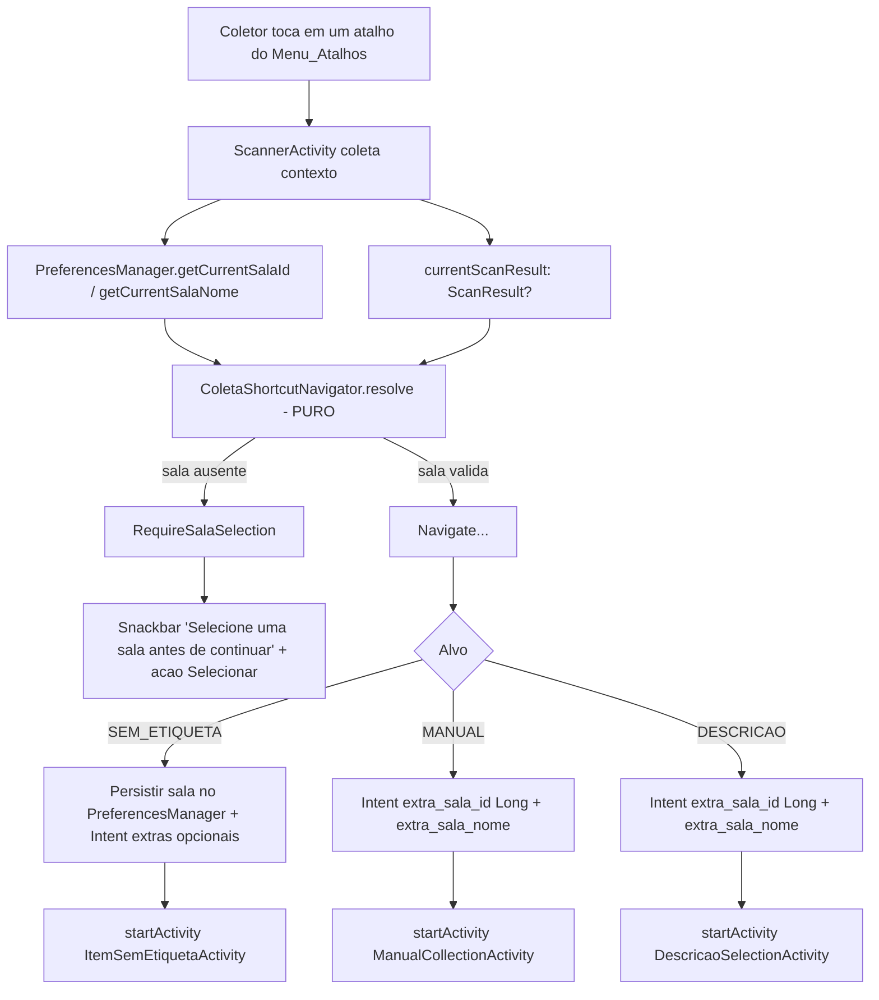
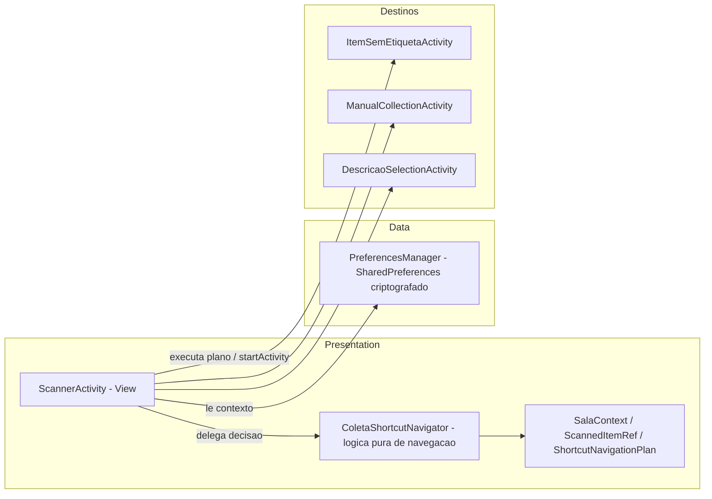

# Design Document

## Overview

Esta feature adiciona um **Menu_Atalhos** à `ScannerActivity` (Tela_Coleta_Rapida) que expõe, de forma discreta e consistente com a UI existente, três atalhos de navegação para os métodos de coleta já implementados:

- **Atalho_Sem_Etiqueta** → `ItemSemEtiquetaActivity`
- **Atalho_Manual** → `ManualCollectionActivity`
- **Atalho_Descricao** → `DescricaoSelectionActivity`

O objetivo é puramente de **consolidação e exposição** de capacidades de navegação já existentes. Nenhum método de coleta novo é criado, nenhum contrato de Intent/extra existente é alterado de forma incompatível e nenhum endpoint funcional de API tem sua URL modificada.

O ponto central do design é separar a **decisão de navegação** (lógica pura, testável) da **execução da navegação** (acoplada ao Android: leitura do `PreferencesManager`, montagem do `Intent`, `startActivity`, feedback de UI). Essa separação respeita o steering `clean-architecture.md` (toda lógica nova segue Clean Architecture + MVVM) e torna o comportamento dos atalhos verificável por testes baseados em propriedades, sem depender do framework Android.

### Decisões de design e justificativas

| Decisão | Justificativa |
|---|---|
| Extrair a decisão de navegação para um resolver puro (`ColetaShortcutNavigator`) | Permite testar a regra de negócio (sala ausente, conversão Int→Long, escolha de extras) sem Android, conforme `clean-architecture.md`. |
| Reusar os nomes de extras já definidos pelas telas de destino | Requisito 9.1 — evita quebrar contratos de Intent em produção (`endpoints-nao-alterar.md`/compatibilidade). |
| `ItemSemEtiquetaActivity` recebe a sala via `PreferencesManager`, não via extra | A tela de destino lê `getCurrentSalaNome()` em `setupSalaInfo()`. O atalho persiste a sala antes de navegar, replicando o padrão já usado por `DescricaoSelectionActivity.setupNovaDescricaoFab()`. |
| `ManualCollectionActivity` e `DescricaoSelectionActivity` recebem `extra_sala_id` (Long) + `extra_sala_nome` | Ambas leem `intent.getLongExtra(EXTRA_SALA_ID, -1L)`; o `PreferencesManager` guarda a sala como `Int`, exigindo conversão `Int.toLong()` (Requisitos 3.3, 4.3). |
| Atalhos implementados como `Chip`/botões na faixa de controles existente | Requisitos 6.1/6.2/6.3 — mesma linguagem visual dos chips `chipSala`/`chipEstado`, posicionados fora da área central de mira. |
| Falhas na persistência/preenchimento de contexto não bloqueiam a navegação | Requisitos 2.3 e 4.4 — a navegação é a ação primária; a perda de contexto é degradação tolerável. |

## Architecture

A feature acrescenta uma camada fina de decisão sobre a `ScannerActivity`. O fluxo de dados segue o padrão MVVM/Clean já adotado: a View captura o toque, lê o contexto local (sala/inventário/scan), delega a decisão ao componente puro e executa o plano retornado.



### Posição na arquitetura (camadas)



O `ColetaShortcutNavigator` é **Kotlin puro** (sem dependência de Android), recebendo apenas tipos primitivos e modelos de dados simples. Toda interação com `Intent`, `PreferencesManager` e UI permanece na `ScannerActivity`.

## Components and Interfaces

### 1. `ColetaShortcut` (enum) — alvos do menu

Identifica o atalho acionado, desacoplando a lógica pura das classes `Activity` do Android.

```kotlin
enum class ColetaShortcut {
    SEM_ETIQUETA,   // -> ItemSemEtiquetaActivity
    MANUAL,         // -> ManualCollectionActivity
    DESCRICAO       // -> DescricaoSelectionActivity
}
```

### 2. `ColetaShortcutNavigator` — decisão pura de navegação

Função pura que recebe o contexto e o atalho acionado e devolve um **plano de navegação**. Não toca em Android, `Intent` ou `PreferencesManager`.

```kotlin
class ColetaShortcutNavigator {

    /**
     * Resolve o plano de navegação para um atalho da Tela_Coleta_Rapida.
     *
     * @param shortcut atalho acionado pelo Coletor
     * @param sala contexto da Sala_Atual lido do PreferencesManager
     * @param itemEscaneado referência opcional ao último Item_Escaneado
     */
    fun resolve(
        shortcut: ColetaShortcut,
        sala: SalaContext,
        itemEscaneado: ScannedItemRef?
    ): ShortcutNavigationPlan {
        if (!sala.isValid) {
            return ShortcutNavigationPlan.RequireSalaSelection
        }
        return when (shortcut) {
            ColetaShortcut.SEM_ETIQUETA -> ShortcutNavigationPlan.NavigateToSemEtiqueta(
                salaParaPersistir = sala,
                descricaoSugerida = itemEscaneado?.descricaoOuFallback(),
                numeroPatrimonioOrigem = itemEscaneado?.numeroPatrimonio
            )
            ColetaShortcut.MANUAL -> ShortcutNavigationPlan.NavigateToManual(
                salaId = sala.salaId.toLong(),
                salaNome = sala.salaNome
            )
            ColetaShortcut.DESCRICAO -> ShortcutNavigationPlan.NavigateToDescricao(
                salaId = sala.salaId.toLong(),
                salaNome = sala.salaNome
            )
        }
    }
}
```

### 3. `ScannerActivity` — integração (View)

Acrescenta o wiring dos atalhos sem alterar o comportamento existente do FAB, do "Coletar similar" nem do tratamento de duplicata (Requisito 9.2). A View é a única que conhece Android.

```kotlin
// Em setupButtonListeners(), reutilizando o estilo dos chips existentes:
binding.chipAtalhoSemEtiqueta.setOnClickListener { acionarAtalho(ColetaShortcut.SEM_ETIQUETA) }
binding.chipAtalhoManual.setOnClickListener     { acionarAtalho(ColetaShortcut.MANUAL) }
binding.chipAtalhoDescricao.setOnClickListener  { acionarAtalho(ColetaShortcut.DESCRICAO) }

private val navigator = ColetaShortcutNavigator()

private fun acionarAtalho(shortcut: ColetaShortcut) {
    val sala = SalaContext(
        salaId = preferencesManager.getCurrentSalaId(),
        salaNome = preferencesManager.getCurrentSalaNome()
    )
    val itemRef = currentScanResult?.let {
        ScannedItemRef(
            numeroPatrimonio = it.patrimonioCodigo,
            descricao = it.patrimonio?.descricao
        )
    }

    when (val plano = navigator.resolve(shortcut, sala, itemRef)) {
        is ShortcutNavigationPlan.RequireSalaSelection -> mostrarAvisoSalaAusente()
        is ShortcutNavigationPlan.NavigateToSemEtiqueta -> executarSemEtiqueta(plano)
        is ShortcutNavigationPlan.NavigateToManual -> executarComExtrasSala(
            ManualCollectionActivity::class.java, plano.salaId, plano.salaNome
        )
        is ShortcutNavigationPlan.NavigateToDescricao -> executarComExtrasSala(
            DescricaoSelectionActivity::class.java, plano.salaId, plano.salaNome
        )
    }
}
```

Execução de cada plano (lado Android):

```kotlin
private fun executarSemEtiqueta(plano: ShortcutNavigationPlan.NavigateToSemEtiqueta) {
    // Req 2.2/2.3: persistência de contexto não pode bloquear a navegação
    runCatching {
        preferencesManager.setCurrentSalaId(plano.salaParaPersistir.salaId)
        preferencesManager.setCurrentSalaNome(plano.salaParaPersistir.salaNome)
    }.onFailure { android.util.Log.w("ScannerActivity", "Falha ao persistir sala: ${it.message}") }

    val intent = Intent(this, ItemSemEtiquetaActivity::class.java).apply {
        plano.descricaoSugerida?.let { putExtra("DESCRICAO_SUGERIDA", it) }       // Req 2.4
        plano.numeroPatrimonioOrigem?.let { putExtra("NUMERO_PATRIMONIO_ORIGEM", it) } // Req 2.4
    }
    startActivity(intent)
}

private fun executarComExtrasSala(target: Class<*>, salaId: Long, salaNome: String) {
    // Req 4.4: falha no preenchimento dos extras não bloqueia a navegação
    val intent = Intent(this, target).apply {
        runCatching {
            putExtra("extra_sala_id", salaId)     // Req 3.2/3.3/4.2/4.3/9.1
            putExtra("extra_sala_nome", salaNome) // Req 3.2/4.2/9.1
        }
    }
    startActivity(intent)
}

private fun mostrarAvisoSalaAusente() {
    // Req 5.1 + 5.2: mensagem + ação imediata para selecionar sala
    Snackbar.make(binding.root, "Selecione uma sala antes de continuar", Snackbar.LENGTH_LONG)
        .setAction("Selecionar") { abrirSelecaoDeSala() }
        .show()
}
```

### 4. Interface visual (Menu_Atalhos)

O Menu_Atalhos é implementado como uma faixa de `com.google.android.material.chip.Chip` (estilo idêntico a `chipSala`/`chipEstado` já presentes), agrupada num `ChipGroup`/`HorizontalScrollView` posicionado na **faixa inferior de controles**, fora da área central de mira do scanner.

| Elemento | id (sugerido) | Rótulo | contentDescription |
|---|---|---|---|
| Atalho_Sem_Etiqueta | `chipAtalhoSemEtiqueta` | "Sem etiqueta" | "Abrir coleta sem etiqueta" |
| Atalho_Manual | `chipAtalhoManual` | "Manual" | "Abrir coleta manual por número" |
| Atalho_Descricao | `chipAtalhoDescricao` | "Descrição" | "Abrir coleta por descrição" |

Requisitos de UI atendidos:

- **6.1** — usa `Chip` Material com o mesmo tema dos chips existentes.
- **6.2 / 6.3** — `ChipGroup` ancorado fora da região de mira (faixa inferior, junto a `chipSala`/`chipEstado`), preservando a visibilidade do alvo de leitura.
- **7.1** — `android:contentDescription` definido por chip.
- **7.2** — feedback visual via ripple do `Chip` + `Snackbar` de confirmação ao navegar.
- **7.3** — `minWidth`/`minHeight` de 48dp por chip (alvo de toque mínimo).

### Tabela de contratos de Intent (reuso — Requisito 9.1)

| Destino | Extra | Tipo | Origem | Obrigatório |
|---|---|---|---|---|
| `ItemSemEtiquetaActivity` | (sala) `current_sala_id` / `current_sala_nome` via `PreferencesManager` | Int / String | `SalaContext` persistido | Sim (lido em `setupSalaInfo()`) |
| `ItemSemEtiquetaActivity` | `DESCRICAO_SUGERIDA` | String | `ScanResult.patrimonio.descricao` | Não (só se houver scan) |
| `ItemSemEtiquetaActivity` | `NUMERO_PATRIMONIO_ORIGEM` | String | `ScanResult.patrimonioCodigo` | Não (só se houver scan) |
| `ManualCollectionActivity` | `extra_sala_id` | Long | `getCurrentSalaId().toLong()` | Sim |
| `ManualCollectionActivity` | `extra_sala_nome` | String | `getCurrentSalaNome()` | Sim |
| `DescricaoSelectionActivity` | `extra_sala_id` | Long | `getCurrentSalaId().toLong()` | Sim |
| `DescricaoSelectionActivity` | `extra_sala_nome` | String | `getCurrentSalaNome()` | Sim |

## Data Models

Modelos puros (Kotlin, sem Android) usados pela lógica de navegação.

```kotlin
/**
 * Contexto da Sala_Atual lido do PreferencesManager.
 * salaId == 0 ou salaNome em branco significam "nenhuma sala selecionada".
 */
data class SalaContext(
    val salaId: Int,
    val salaNome: String
) {
    /** Sala válida exige id > 0 E nome não vazio (Requisito 5.1). */
    val isValid: Boolean
        get() = salaId > 0 && salaNome.isNotBlank()
}

/**
 * Referência ao último Item_Escaneado disponível na Tela_Coleta_Rapida.
 * Espelha apenas os campos relevantes do ScanResult para a navegação.
 */
data class ScannedItemRef(
    val numeroPatrimonio: String?,
    val descricao: String?
) {
    /** Descrição sugerida com fallback baseado no número (espelha o fluxo de duplicata existente). */
    fun descricaoOuFallback(): String? = when {
        !descricao.isNullOrBlank() -> descricao
        !numeroPatrimonio.isNullOrBlank() -> "Patrimônio $numeroPatrimonio"
        else -> null
    }
}

/**
 * Plano de navegação resultante da decisão pura. A View apenas executa.
 */
sealed class ShortcutNavigationPlan {

    /** Sala_Atual ausente: exibir aviso e permanecer na tela (Requisito 5.1/5.2). */
    object RequireSalaSelection : ShortcutNavigationPlan()

    /** Navegar para coleta sem etiqueta, persistindo a sala e (opcionalmente) extras do scan. */
    data class NavigateToSemEtiqueta(
        val salaParaPersistir: SalaContext,
        val descricaoSugerida: String?,
        val numeroPatrimonioOrigem: String?
    ) : ShortcutNavigationPlan()

    /** Navegar para coleta manual com extras de sala (id em Long). */
    data class NavigateToManual(
        val salaId: Long,
        val salaNome: String
    ) : ShortcutNavigationPlan()

    /** Navegar para coleta por descrição com extras de sala (id em Long). */
    data class NavigateToDescricao(
        val salaId: Long,
        val salaNome: String
    ) : ShortcutNavigationPlan()
}
```

### Mapeamento estado → plano

| Estado de entrada | Plano resultante |
|---|---|
| `sala.isValid == false`, qualquer atalho | `RequireSalaSelection` |
| `SEM_ETIQUETA` + sala válida + scan presente | `NavigateToSemEtiqueta` com `descricaoSugerida` e `numeroPatrimonioOrigem` |
| `SEM_ETIQUETA` + sala válida + sem scan | `NavigateToSemEtiqueta` com ambos `null` |
| `MANUAL` + sala válida | `NavigateToManual(salaId = id.toLong(), salaNome)` |
| `DESCRICAO` + sala válida | `NavigateToDescricao(salaId = id.toLong(), salaNome)` |

## Correctness Properties

*A property is a characteristic or behavior that should hold true across all valid executions of a system — essentially, a formal statement about what the system should do. Properties serve as the bridge between human-readable specifications and machine-verifiable correctness guarantees.*

A lógica de decisão de navegação (`ColetaShortcutNavigator.resolve`) é uma função pura: dado um contexto de sala, um atalho e uma referência opcional ao item escaneado, ela retorna um `ShortcutNavigationPlan` determinístico, sem efeitos colaterais e sem dependência de Android, rede ou `PreferencesManager`. Isso a torna ideal para testes baseados em propriedades. As propriedades abaixo resultam da pré-análise das acceptance criteria, após reflexão para eliminar redundâncias (os critérios 2.1/3.1/4.1/8.1 foram consolidados; 3.2/3.3/4.2/4.3 foram consolidados).

### Property 1: Sala válida sempre mapeia cada atalho ao seu destino correspondente

*For any* `SalaContext` válido (id > 0 e nome não vazio) e *para qualquer* `ScannedItemRef` (presente ou `null`), `resolve(shortcut, sala, item)` retorna o plano correspondente ao atalho: `SEM_ETIQUETA` → `NavigateToSemEtiqueta`, `MANUAL` → `NavigateToManual`, `DESCRICAO` → `NavigateToDescricao` (nunca `RequireSalaSelection`). Como o resolver não recebe entrada de rede, este mapeamento vale igualmente em Modo_Offline.

**Validates: Requirements 2.1, 3.1, 4.1, 8.1**

### Property 2: Preservação do contexto da sala e conversão Int→Long

*For any* `SalaContext` válido: (a) para `shortcut` em {`MANUAL`, `DESCRICAO`}, o plano resultante carrega `salaNome` idêntico a `sala.salaNome` e `salaId` (Long) exatamente igual a `sala.salaId.toLong()` — preservando o valor numérico (round-trip `salaId.toInt() == sala.salaId`); (b) para `SEM_ETIQUETA`, o plano carrega `salaParaPersistir` idêntico ao `sala` de entrada (a sala que a View persistirá no PreferencesManager).

**Validates: Requirements 2.2, 3.2, 3.3, 4.2, 4.3**

### Property 3: Extras dependentes do item escaneado, com fallback de descrição

*For any* `SalaContext` válido ao acionar `SEM_ETIQUETA`: se existe `ScannedItemRef`, o `NavigateToSemEtiqueta` carrega `numeroPatrimonioOrigem` igual ao número do item e `descricaoSugerida` igual à descrição do item quando presente, ou ao fallback `"Patrimônio {numero}"` quando a descrição é vazia/nula mas há número; se **não** existe `ScannedItemRef`, tanto `descricaoSugerida` quanto `numeroPatrimonioOrigem` são `null`.

**Validates: Requirements 2.4, 2.5**

### Property 4: Ausência de sala bloqueia qualquer atalho

*For any* `shortcut` (qualquer um dos três) e *para qualquer* `SalaContext` inválido (`salaId <= 0` **ou** `salaNome` em branco/somente espaços), `resolve` retorna `RequireSalaSelection` e **nenhum** plano de navegação — independentemente de existir item escaneado.

**Validates: Requirements 5.1**

## Error Handling

A feature tem superfície de erro pequena, pois reutiliza navegação e telas já existentes. Os pontos de falha relevantes e suas estratégias:

| Cenário | Estratégia | Requisito |
|---|---|---|
| Sala_Atual ausente ao acionar atalho | Decisão pura retorna `RequireSalaSelection`; a View exibe `Snackbar` "Selecione uma sala antes de continuar" com ação "Selecionar" e permanece na tela. Nenhuma navegação é disparada. | 5.1, 5.2 |
| Falha ao persistir a Sala_Atual no `PreferencesManager` (Atalho_Sem_Etiqueta) | A escrita é envolvida em `runCatching`; em falha, registra `Log.w` e **prossegue** com `startActivity`. A tela de destino exibirá "Nenhuma sala selecionada" (degradação tolerável). | 2.3 |
| Falha ao preencher extras de sala (Atalho_Descricao / Atalho_Manual) | O preenchimento de extras é envolvido em `runCatching`; em falha, navega mesmo assim. As telas de destino já validam `salaId <= 0` e exibem erro/`finish()` quando necessário — comportamento existente preservado. | 4.4 |
| `ScanResult` sem descrição mas com número | `descricaoOuFallback()` usa `"Patrimônio {numero}"`, espelhando o fluxo de duplicata já presente em `ScannerActivity`/`ManualCollectionActivity`. | 2.4 |
| `currentScanResult == null` (nenhum scan ainda) | Navega para `ItemSemEtiquetaActivity` sem os extras `DESCRICAO_SUGERIDA`/`NUMERO_PATRIMONIO_ORIGEM`. | 2.5 |
| Destino recebe sala inválida apesar dos atalhos | Cada Activity de destino já trata o caso (`ManualCollectionActivity` e `DescricaoSelectionActivity` chamam `finish()` com Toast; `ItemSemEtiquetaActivity` mostra "Nenhuma sala selecionada"). Não é alterado. | 9.2 |

**Princípio**: a navegação é a ação primária e não deve ser abortada por falhas de preservação de contexto (Requisitos 2.3 e 4.4). Falhas de contexto degradam graciosamente para o comportamento já existente das telas de destino.

## Testing Strategy

A feature possui **duas naturezas distintas**:

1. **Lógica de decisão de navegação** (`ColetaShortcutNavigator` + modelos puros) — pura, determinística, com propriedades universais → **adequada a Property-Based Testing (PBT)**.
2. **Integração de UI/Android** (renderização dos chips, `Intent`, `startActivity`, `Snackbar`, leitura de `PreferencesManager`, layout/acessibilidade) — efeitos colaterais e rendering → **testes de exemplo/instrumentados**, não PBT.

### Testes Baseados em Propriedades (lógica pura)

- **Biblioteca**: usar uma biblioteca de PBT já madura para Kotlin/JVM — **kotest-property** (`io.kotest:kotest-property`) ou jqwik. Não implementar PBT do zero.
- **Configuração**: cada teste de propriedade roda no mínimo **100 iterações** (ex.: `PropTestConfig(iterations = 100)` no kotest, ou `@Property(tries = 100)` no jqwik).
- **Geradores**:
  - `SalaContext` válido: `salaId` em `1..Int.MAX_VALUE`, `salaNome` não-branco (incluir acentos/unicode).
  - `SalaContext` inválido: `salaId <= 0` (incluindo o limite `0` e negativos) **ou** `salaNome` em branco/somente espaços/tabs.
  - `ScannedItemRef`: combinações de `numeroPatrimonio` (nulo, vazio, alfanumérico) e `descricao` (nula, vazia, whitespace, texto), além de `null` para "sem scan".
  - `ColetaShortcut`: gerador uniforme sobre os três valores do enum.
- **Tag obrigatória** em cada teste, referenciando a propriedade do design:
  `// Feature: atalhos-coleta-rapida, Property {n}: {texto da propriedade}`
- **Mapeamento propriedade → teste** (uma propriedade = um teste de propriedade):
  - Property 1 → `resolve` mapeia atalho válido ao Navigate* correspondente (cobre offline implicitamente).
  - Property 2 → preservação de `salaNome` e conversão `salaId.toLong()` para MANUAL/DESCRICAO + `salaParaPersistir == sala` para SEM_ETIQUETA.
  - Property 3 → extras dependentes do scan, com fallback de descrição.
  - Property 4 → sala inválida sempre resulta em `RequireSalaSelection`, para todos os atalhos.

### Testes de Exemplo / Unitários (casos concretos e bordas)

- `descricaoOuFallback()`: descrição presente → retorna descrição; descrição vazia + número → `"Patrimônio {n}"`; ambos vazios → `null`.
- `SalaContext.isValid`: tabela de casos de borda (`id=0`, `id=-1`, nome `""`, nome `"  "`, par válido).
- Caso "sem scan": `resolve(SEM_ETIQUETA, salaVálida, null)` → plano sem extras.

### Testes de Integração / Instrumentados (Android — Espresso/Robolectric)

- **Navegação real**: ao tocar cada chip com sala válida, um `Intent` para a Activity correta é disparado, contendo as chaves de extra exatas (`extra_sala_id` Long, `extra_sala_nome`, e, quando aplicável, `DESCRICAO_SUGERIDA`/`NUMERO_PATRIMONIO_ORIGEM`) — **Requisito 9.1**.
- **Persistência (Atalho_Sem_Etiqueta)**: após o toque, `PreferencesManager` contém a sala atual; com `PreferencesManager` que lança exceção, `startActivity` ainda é chamado — **Requisitos 2.2, 2.3**.
- **Falha de extras (Atalho_Descricao/Manual)**: simular falha de preenchimento e verificar que a navegação prossegue — **Requisito 4.4**.
- **Sala ausente**: `Snackbar` com o texto exato e ação "Selecionar"; a tela não navega — **Requisitos 5.1, 5.2**.
- **Presença/estilo dos controles**: os três chips são exibidos, rotulados, com `contentDescription` e alvo de toque ≥ 48dp; controles preexistentes (chipSala, chipEstado, FAB, coletar similar) permanecem visíveis — **Requisitos 1.1–1.4, 6.1–6.3, 7.1–7.3**.
- **Regressão**: fluxos de FAB sem etiqueta, "Coletar similar" e tratamento de duplicata permanecem inalterados — **Requisito 9.2**.

### Smoke / Revisão de Código

- Verificar, por revisão e build, que nenhuma URL de endpoint funcional foi alterada e que as chaves de extra batem com as constantes das telas de destino — **Requisitos 9.1, 9.3** (alinhado ao steering `endpoints-nao-alterar.md`).
