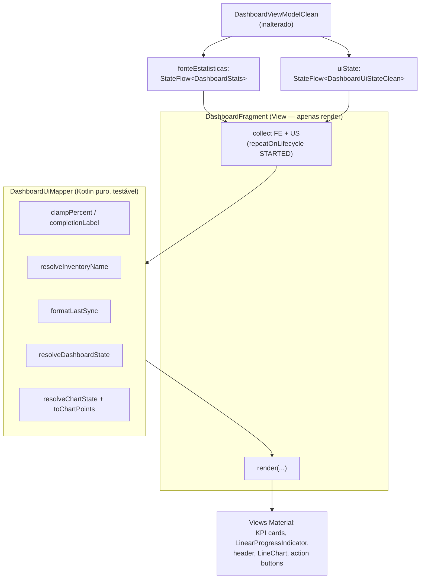

# Design Document

## Overview

Este documento descreve o design técnico do **redesign da camada de apresentação** do Dashboard do app Android `InventarioMobile`. O objetivo é tornar a tela mais **profissional** (visual corporativo, limpo e consistente), sem criar nova lógica de negócio, novos endpoints ou alterar o contrato de dados.

Princípios que guiam o design:

- **Fragment apenas renderiza** (Clean Architecture + MVVM, Req 9.1). Toda decisão de "qual estado mostrar", "como formatar um percentual" ou "como truncar um nome" é extraída para **funções puras testáveis** num helper de apresentação (`DashboardUiMapper`), mantendo o `DashboardFragment` como uma camada fina de binding.
- **Fonte única de verdade** preservada: KPIs continuam vindo exclusivamente de `viewModel.fonteEstatisticas` (Req 8.5), e loading/erro/gráfico continuam vindo de `viewModel.uiState`.
- **Sem mudanças de contrato**: consome `DashboardStats`, `EvolucaoColeta`, `DashboardUiStateClean` e `loadColetasEvolucao(inventarioId)` exatamente como já existem (Req 9.2). Nenhuma URL `api/mobile/` é tocada (Req 9.3). O comportamento offline-first permanece intacto (Req 9.4).
- **Material 3 + sistema de 8dp + TextAppearance do tema**: o app já define um tema Material 3 (`Theme.InventarioMobile`) com escala completa de `TextAppearance.App.*` e escala de shapes. O redesign reusa esses tokens em vez de definir tamanhos/pesos/cores ad-hoc.

### Lacunas fechadas pelo redesign

O design atual (em `fragment_dashboard.xml`) tem três problemas que este redesign corrige:

1. **KPIs com gradientes saturados e sombras de texto** (`gradient_success`, `gradient_warning`, `shadowDx/Dy/Radius`) → substituídos por cartões de superfície neutra com um único realce por cartão.
2. **Gráfico de evolução nunca exibido** — `loadColetasEvolucao(...)` calcula dados (`uiState.coletasEvolucao`) que não são renderizados → adiciona-se uma área de gráfico MPAndroidChart com estados de loading/vazio/erro.
3. **Timestamp da última sincronização apenas logado** (`atualizarTimestampUltimaSync` só faz `Log.d`) → passa a ser exibido na área de cabeçalho.

### Escopo

| Em escopo | Fora de escopo |
|-----------|----------------|
| `fragment_dashboard.xml` (layout) | Qualquer alteração em `DashboardViewModelClean` |
| `DashboardFragment.kt` (binding/render) | Qualquer alteração em `DashboardStats` / `EvolucaoColeta` |
| Novo `DashboardUiMapper.kt` (lógica pura de apresentação) | Qualquer endpoint `api/mobile/*` |
| Recursos: `colors.xml`, `themes.xml`, `strings.xml`, drawables de estado | Repositórios, Use Cases, Room, Retrofit |

## Architecture

O redesign mantém o fluxo MVVM existente e **introduz uma camada de mapeamento de apresentação pura** entre o ViewModel e a View. Isso satisfaz Req 9.1 (Fragment só renderiza) e torna a lógica de apresentação (clamp de percentual, truncamento de nome, resolução de estado, mapeamento do gráfico) testável sem Android.



### Camadas e responsabilidades

- **ViewModel (inalterado)**: continua expondo `fonteEstatisticas` (KPIs, offline, timestamp, nome do inventário) e `uiState` (loading/erro/evolução). O pull-to-refresh continua chamando `viewModel.refresh()` + `viewModel.loadColetasEvolucao(inventarioId)`.
- **DashboardUiMapper (novo, puro)**: funções `object`/top-level sem dependência de `View`/`Context` que transformam `DashboardStats` + `DashboardUiStateClean` em valores prontos para render (texto, percentual inteiro, `DashboardScreenState`, `ChartAreaState`, lista de `ChartPoint`). É aqui que mora toda a lógica testável por propriedade.
- **DashboardFragment (render fino)**: coleta os flows (já faz isso hoje), chama o mapper e aplica resultados aos componentes Material. Não decide regras; só seta `text`, `visibility`, `progress`, e converte `ChartPoint` → `Entry` do MPAndroidChart.

### Decisão de design: estado de tela como função pura

Os requisitos 6.6, 6.3–6.5, 4.4–4.6 exigem que **no máximo um** entre Loading/Vazio/Erro esteja visível, e que o conteúdo só apareça quando nenhum estado especial estiver ativo. Em vez de espalhar `if/else` de `visibility` pelo Fragment (propenso a bugs de estados simultâneos), o design centraliza essa decisão em duas funções puras que retornam um `sealed class` de estado mutuamente exclusivo. O Fragment apenas faz um `when(state)` e mostra a região correspondente. Isso torna a invariante "exatamente um estado" verificável por teste de propriedade.

### Decisão de design: `ChartPoint` intermediário

Para manter o mapeamento do gráfico testável sem instanciar tipos Android do MPAndroidChart (`Entry`, `LineDataSet`), o mapper produz uma lista de `ChartPoint(index, value, label)` puro. O Fragment converte `ChartPoint` → `com.github.mikephil.charting.data.Entry` na hora de renderizar. Assim a propriedade "um ponto por item, preservando ordem e quantidade" é testada em Kotlin puro.

## Components and Interfaces

### 1. DashboardUiMapper (novo arquivo Kotlin puro)

Local: `presentation/dashboard/DashboardUiMapper.kt`. Sem imports de `android.*` (exceto `java.text`/`java.util` para formatação de data, que roda na JVM de teste).

```kotlin
object DashboardUiMapper {

    // --- Indicador de conclusão (Req 2.2, 2.3, 2.5) ---

    /** Arredonda ao inteiro mais próximo e restringe a [0,100].
     *  null, NaN, valores < 0 → 0 ; valores > 100 → 100. */
    fun clampPercent(value: Double?): Int

    /** Rótulo "X% concluído" usando clampPercent(value). */
    fun completionLabel(value: Double?): String

    // --- Cabeçalho (Req 3.1, 3.2, 3.3, 3.4, 3.5, 3.6) ---

    /** Saudação não vazia, no máximo 60 caracteres. Pode variar por hora do dia. */
    fun greeting(hourOfDay: Int): String

    /** Nome do inventário para exibição:
     *  - nome presente: trunca a 80 chars com reticências se exceder
     *  - nome nulo + id presente: substituto "Inventário <id>"
     *  - ambos nulos: placeholder genérico ("Nenhum inventário ativo") */
    fun resolveInventoryName(inventarioNome: String?, inventarioId: Int?): String

    /** Timestamp formatado "dd/MM/yyyy HH:mm" (24h) ou null quando timestamp é null. */
    fun formatLastSync(timestamp: Long?): String?

    // --- KPIs (Req 1.5, 1.6) ---

    /** Mapeia DashboardStats para os textos dos 4 cartões (valores inteiros). */
    fun kpiValues(stats: DashboardStats): KpiValues

    // --- Estado da tela (Req 6.3, 6.4, 6.5, 6.6) ---

    fun resolveDashboardState(
        uiState: DashboardUiStateClean,
        stats: DashboardStats
    ): DashboardScreenState

    // --- Estado e dados do gráfico (Req 4.2, 4.4, 4.5, 4.6) ---

    fun resolveChartState(uiState: DashboardUiStateClean): ChartAreaState

    /** Um ChartPoint por EvolucaoColeta, preservando ordem; value = quantidade. */
    fun toChartPoints(evolucao: List<EvolucaoColeta>): List<ChartPoint>

    // --- Indicador offline (Req 8.2) ---

    /** true quando o indicador offline deve ser exibido por causa dos dados. */
    fun shouldShowOfflineFromData(stats: DashboardStats): Boolean
}
```

Tipos de apoio (puros):

```kotlin
data class KpiValues(
    val coletados: String,
    val pendentes: String,
    val divergencias: String,
    val coletores: String
)

data class ChartPoint(val index: Int, val value: Float, val label: String)

sealed class DashboardScreenState {
    object Loading : DashboardScreenState()                 // skeleton/placeholder
    object Empty : DashboardScreenState()                   // sem inventário identificável
    data class Error(val message: String) : DashboardScreenState()
    data class Content(val stats: DashboardStats) : DashboardScreenState()
}

sealed class ChartAreaState {
    object Loading : ChartAreaState()
    object Empty : ChartAreaState()
    data class Error(val message: String) : ChartAreaState()
    data class Data(val points: List<ChartPoint>) : ChartAreaState()
}
```

Regras de resolução (determinísticas, prioridade fixa):

- `resolveDashboardState`:
  1. `uiState.isLoading == true` → `Loading`
  2. senão, `uiState.error != null` → `Error(error)` (os `stats` previamente carregados permanecem em memória; ver Error Handling)
  3. senão, inventário não identificável (`stats.inventarioNome == null && stats.inventarioId == null`) → `Empty`
  4. senão → `Content(stats)`
- `resolveChartState`:
  1. `uiState.isLoadingGrafico == true` → `Loading`
  2. senão, `uiState.graficoError != null` → `Error(graficoError)`
  3. senão, `uiState.coletasEvolucao.isEmpty()` → `Empty`
  4. senão → `Data(toChartPoints(coletasEvolucao))`

A prioridade garante exclusividade mútua (no máximo um estado especial; conteúdo só no caso default).

### 2. DashboardFragment (modificado — apenas render)

Mudanças mínimas e aditivas; toda a lógica delegada ao mapper. Métodos existentes de voz, navegação, offline e refresh são **preservados** (Req 8.x). O bloco de coleta de flows já existe; passa a chamar o mapper.

```kotlin
private fun render(stats: DashboardStats, uiState: DashboardUiStateClean) {
    // KPIs (Req 1.5, 1.6)
    val kpis = DashboardUiMapper.kpiValues(stats)
    binding.tvKpiColetados.text = kpis.coletados
    binding.tvKpiPendentes.text = kpis.pendentes
    binding.tvKpiDivergencias.text = kpis.divergencias
    binding.tvKpiColetores.text = kpis.coletores

    // Indicador de conclusão (Req 2.2, 2.3, 2.5)
    val percent = DashboardUiMapper.clampPercent(stats.percentualConclusao)
    binding.progressCompletion.setProgressCompat(percent, true)
    binding.tvCompletionLabel.text = DashboardUiMapper.completionLabel(stats.percentualConclusao)

    // Cabeçalho (Req 3.x)
    binding.tvGreeting.text = DashboardUiMapper.greeting(currentHourOfDay())
    binding.tvInventoryName.text =
        DashboardUiMapper.resolveInventoryName(stats.inventarioNome, stats.inventarioId)
    val sync = DashboardUiMapper.formatLastSync(stats.timestampUltimaSincronizacao)
    binding.tvLastSync.visibility = if (sync == null) View.GONE else View.VISIBLE
    sync?.let { binding.tvLastSync.text = getString(R.string.last_sync_format, it) }

    // Estado global da tela (Req 6.3–6.6)
    applyDashboardState(DashboardUiMapper.resolveDashboardState(uiState, stats))

    // Estado da área do gráfico (Req 4.2, 4.4–4.6)
    applyChartState(DashboardUiMapper.resolveChartState(uiState))
}

private fun applyChartState(state: ChartAreaState) {
    binding.chartLoading.visibility = View.GONE
    binding.chartEmpty.visibility = View.GONE
    binding.chartError.visibility = View.GONE
    binding.chartEvolucao.visibility = View.GONE
    when (state) {
        is ChartAreaState.Loading -> binding.chartLoading.visibility = View.VISIBLE
        is ChartAreaState.Empty -> binding.chartEmpty.visibility = View.VISIBLE
        is ChartAreaState.Error -> {
            binding.chartError.text = state.message
            binding.chartError.visibility = View.VISIBLE
        }
        is ChartAreaState.Data -> {
            renderChart(state.points)               // ChartPoint -> Entry
            binding.chartEvolucao.visibility = View.VISIBLE
        }
    }
}
```

`renderChart` converte `List<ChartPoint>` em `LineDataSet`/`LineData` do MPAndroidChart, aplica um `ValueFormatter` que usa `ChartPoint.label` no eixo X (campo `data` de cada `EvolucaoColeta`) e estiliza a linha com cores neutras/realce do tema.

### 3. Layout `fragment_dashboard.xml` (redesenhado)

Estrutura (de cima para baixo, dentro do `ScrollView` existente sob `SwipeRefreshLayout`):

```
SwipeRefreshLayout (id: swipeRefresh — preservado)
└─ ScrollView
   └─ LinearLayout (vertical, padding 16dp — múltiplo de 8)
      ├─ layoutOfflineIndicator (preservado — Req 8.2)
      ├─ [HEADER] MaterialCardView ou LinearLayout (Req 3.x)
      │   ├─ tvGreeting        (TextAppearance.App.TitleMedium)
      │   ├─ tvInventoryName   (TextAppearance.App.HeadlineSmall, maxLines=1, ellipsize=end)
      │   └─ tvLastSync        (TextAppearance.App.BodySmall, visibility=gone por padrão)
      ├─ [CONCLUSÃO] (Req 2.x)
      │   ├─ tvCompletionLabel (TextAppearance.App.LabelLarge)
      │   └─ progressCompletion (LinearProgressIndicator, max=100, indeterminate=false)
      ├─ [KPIs] grade 2x2 (Req 1.x)
      │   ├─ Linha 1: cardColetados | cardPendentes
      │   └─ Linha 2: cardDivergencias | cardColetores
      │       cada card: MaterialCardView (cardBackgroundColor=?attr/colorSurface,
      │       cardElevation baixo, sem gradiente) contendo ícone (tint de realce),
      │       tvKpiXxx (TextAppearance.App.HeadlineSmall, sem shadow), rótulo neutro
      ├─ [GRÁFICO] (Req 4.x)
      │   ├─ título "Evolução de Coletas"
      │   ├─ chartEvolucao (com.github.mikephil.charting.charts.LineChart, 200dp)
      │   ├─ chartLoading (ProgressBar/skeleton, gone)
      │   ├─ chartEmpty   (TextView/estado vazio, gone)
      │   └─ chartError   (TextView, gone)
      ├─ [AÇÕES] (Req 5.x)
      │   ├─ btnQuickScan          (preservado — filled, ação primária)
      │   ├─ btnManualCollection   (preservado — outlined secundário)
      │   ├─ btnDescriptionCollection (preservado — outlined secundário)
      │   └─ btnViewCollections    (preservado — outlined secundário)
      ├─ progressBar (preservado — loading global)
      └─ tvError (preservado — Estado_Erro global, Req 6.5)
FAB fabVoiceSearch (preservado — Req 7.1, 8.3)
voiceListeningOverlay (preservado — Req 8.3, 8.4)
```

Decisões de layout chave:

- **Grade 2x2 com larguras/alturas idênticas (Req 1.3)**: duas `LinearLayout` horizontais; cada card com `layout_width=0dp` + `layout_weight=1`; altura fixa idêntica (ex.: `120dp`) ou um card com altura fixa e os demais espelhando o mesmo valor. Espaçamentos entre cards e linhas em múltiplos de 8dp (Req 6.2).
- **Cartões neutros (Req 1.1, 1.2, 1.4)**: `app:cardBackgroundColor="?attr/colorSurface"`; remoção total dos `@drawable/gradient_*` e dos atributos `shadow*`; um único realce por card aplicado via `app:tint` no ícone (e opcionalmente cor no número), com rótulos em `?attr/colorOnSurfaceVariant`.
- **Botões consistentes (Req 5.1–5.4)**: `btnQuickScan` usa estilo filled Material 3 (`Widget.Material3.Button`); os três secundários usam o mesmo estilo outlined (`Widget.Material3.Button.OutlinedButton`); `app:cornerRadius` idêntico nos quatro (via shape do tema ou valor único); mesmo `android:textAppearance`; `layout_marginBottom` igual (múltiplo de 8dp) entre adjacentes.
- **Indicador de conclusão (Req 2.1)**: `com.google.android.material.progressindicator.LinearProgressIndicator` com `app:indicatorColor`, `android:max="100"`, determinado.
- **Acessibilidade (Req 7.1, 7.2)**: `contentDescription` em todos os ícones/`ImageView` e no FAB (já presente); alvos de toque ≥48dp (botões com `minHeight=48dp`; FAB padrão já ≥48dp).

### 4. Recursos (resources)

- `strings.xml`: novas strings — `dashboard_greeting_*`, `completion_label_format` ("%d%% concluído"), `last_sync_format` ("Última sincronização: %s"), `chart_title`, `chart_empty`, `chart_error`, `dashboard_empty`, `no_active_inventory`, e `contentDescription` dos ícones de KPI.
- `themes.xml`: opcionalmente um estilo `Widget.App.Dashboard.KpiCard` e `Widget.App.Dashboard.ActionButton` para centralizar corner radius/elevação e garantir consistência (Req 5.1, 5.3).
- `colors.xml`: reuso de cores existentes (`success`, `warning`, `error`, `info`, `md3_*`). Nenhuma cor saturada de preenchimento de card; realces aplicados só a ícone/valor.

## Data Models

Todos os modelos são **existentes e inalterados** (Req 9.2). O design apenas os consome.

### DashboardStats (domínio, inalterado)

Campos consumidos pelo redesign:

| Campo | Tipo | Uso no Dashboard |
|-------|------|------------------|
| `totalColetados` | `Int` | Cartão Coletados (Req 1.5) |
| `totalPendentes` | `Int` | Cartão Pendentes (Req 1.5) |
| `divergencias` | `Int` | Cartão Divergências (Req 1.5) |
| `coletoresAtivos` | `Int` | Cartão Coletores (Req 1.5) |
| `percentualConclusao` | `Double` | Indicador + rótulo de conclusão (Req 2.2, 2.3, 2.5) |
| `inventarioNome` | `String?` | Nome no cabeçalho (Req 3.2, 3.4) |
| `inventarioId` | `Int?` | Substituto de nome / vazio (Req 3.4, 3.6) |
| `timestampUltimaSincronizacao` | `Long?` | Última sync no cabeçalho (Req 3.3, 3.5) |
| `isOfflineData` | `Boolean` | Indicador offline (Req 8.2) |

> Nota: `percentualConclusao` é `Double`. Embora o `init {}` de `DashboardStats` imponha não-negatividade de contagens, ele **não** valida o intervalo de `percentualConclusao`. Por isso o clamp em `DashboardUiMapper.clampPercent` é necessário para Req 2.5 (valores < 0, > 100 ou `NaN`).

### EvolucaoColeta (domínio, inalterado)

| Campo | Tipo | Uso |
|-------|------|-----|
| `data` | `String` (ISO "2025-11-15") | Rótulo do eixo X do gráfico (Req 4.2) |
| `quantidade` | `Int` | Valor do ponto no gráfico (Req 4.2) |
| `getDataExibicao()` | `String` ("15/11") | Rótulo curto opcional para o eixo |

### DashboardUiStateClean (apresentação, inalterado)

| Campo | Tipo | Uso |
|-------|------|-----|
| `isLoading` | `Boolean` | Estado de carregamento global (Req 6.3) |
| `error` | `String?` | Estado de erro global via `tvError` (Req 6.5) |
| `isLoadingGrafico` | `Boolean` | Loading da área do gráfico (Req 4.4) |
| `coletasEvolucao` | `List<EvolucaoColeta>` | Dados do gráfico (Req 4.2, 4.5) |
| `graficoError` | `String?` | Erro da área do gráfico (Req 4.6) |

### Novos tipos de apresentação (puros, internos ao redesign)

`KpiValues`, `ChartPoint`, `DashboardScreenState`, `ChartAreaState` — definidos na seção Components and Interfaces. Não fazem parte do contrato de domínio nem de API; são detalhes internos da camada de View.

## Correctness Properties

*A property is a characteristic or behavior that should hold true across all valid executions of a system — essentially, a formal statement about what the system should do. Properties serve as the bridge between human-readable specifications and machine-verifiable correctness guarantees.*

A maioria dos critérios de aceitação deste redesign é de natureza **visual/estática** (cor de fundo de card, ausência de gradiente, raio de canto, espaçamento de 8dp, tipografia, `contentDescription`), e portanto **não** é adequada para property-based testing — esses são verificados por inspeção de layout/snapshot e revisão (ver Testing Strategy). As propriedades abaixo cobrem exclusivamente a **lógica de apresentação pura** extraída para `DashboardUiMapper`, onde o comportamento varia com a entrada e existe uma invariante universal.

### Property 1: Mapeamento de KPIs reflete os campos corretos

*For any* `DashboardStats`, `DashboardUiMapper.kpiValues(stats)` produz os textos dos quatro cartões iguais às representações inteiras dos campos correspondentes: `coletados == stats.totalColetados.toString()`, `pendentes == stats.totalPendentes.toString()`, `divergencias == stats.divergencias.toString()`, `coletores == stats.coletoresAtivos.toString()`.

**Validates: Requirements 1.5, 1.6**

### Property 2: Percentual de conclusão é arredondado e restrito a [0,100]

*For any* valor `Double?` (incluindo `null`, `NaN`, negativos, maiores que 100 e valores fracionários), `DashboardUiMapper.clampPercent(value)` retorna um inteiro no intervalo fechado `[0,100]`; vale 0 para `null`/`NaN`/valores ≤ 0, vale 100 para valores ≥ 100 e, para valores em `(0,100)`, é igual ao arredondamento ao inteiro mais próximo restrito a esse intervalo.

**Validates: Requirements 2.2, 2.5**

### Property 3: Rótulo de conclusão contém o inteiro clampado e não tem decimais

*For any* valor `Double?`, `DashboardUiMapper.completionLabel(value)` contém exatamente o inteiro `clampPercent(value)` e não contém separador decimal (não exibe casas decimais).

**Validates: Requirements 2.3**

### Property 4: Saudação é não vazia e respeita o limite de comprimento

*For any* hora do dia no intervalo `0..23`, `DashboardUiMapper.greeting(hour)` retorna um texto não vazio com no máximo 60 caracteres.

**Validates: Requirements 3.1**

### Property 5: Nome do inventário é truncado a 80 caracteres com reticências

*For any* `inventarioNome: String?` e `inventarioId: Int?`, `DashboardUiMapper.resolveInventoryName(nome, id)` retorna um texto não vazio com no máximo 80 caracteres; quando `nome` é não nulo e excede 80 caracteres, o resultado termina com reticências (…) e seu prefixo corresponde ao início de `nome`; quando `nome` é nulo e `id` não nulo, o resultado contém o `id`; quando ambos são nulos, retorna um texto substituto genérico não vazio.

**Validates: Requirements 3.2, 3.4, 3.6**

### Property 6: Formatação da última sincronização é fiel ao instante (round-trip ao minuto)

*For any* `timestamp: Long?`, `DashboardUiMapper.formatLastSync(timestamp)` retorna `null` quando `timestamp` é nulo; caso contrário, retorna uma string no padrão `dd/MM/yyyy HH:mm` (24h) que, ao ser reparseada com o mesmo padrão e fuso, corresponde ao `timestamp` original truncado ao minuto.

**Validates: Requirements 3.3, 3.5**

### Property 7: Mapeamento de pontos do gráfico preserva ordem, quantidade e rótulo

*For any* `List<EvolucaoColeta>`, `DashboardUiMapper.toChartPoints(lista)` produz exatamente um ponto por item, na mesma ordem da lista, com `value` igual a `quantidade` do item e `label` igual ao campo `data` do item (e índices sequenciais a partir de 0).

**Validates: Requirements 4.2**

### Property 8: Estado global da tela é mutuamente exclusivo e priorizado

*For any* par `(DashboardUiStateClean, DashboardStats)`, `DashboardUiMapper.resolveDashboardState(uiState, stats)` retorna exatamente um dentre `Loading`, `Error`, `Empty` ou `Content`, seguindo a prioridade `Loading` (quando `isLoading`) > `Error` (quando `error != null`) > `Empty` (quando `inventarioNome` e `inventarioId` ambos nulos) > `Content`; em particular, `Content` é retornado se e somente se não há loading, não há erro e há inventário identificável.

**Validates: Requirements 6.3, 6.4, 6.5, 6.6**

### Property 9: Estado da área do gráfico é mutuamente exclusivo e priorizado

*For any* `DashboardUiStateClean`, `DashboardUiMapper.resolveChartState(uiState)` retorna exatamente um dentre `Loading`, `Error`, `Empty` ou `Data`, seguindo a prioridade `Loading` (quando `isLoadingGrafico`) > `Error` (quando `graficoError != null`) > `Empty` (quando `coletasEvolucao` vazia) > `Data`; em particular, `Data` é retornado se e somente se não há loading do gráfico, não há erro do gráfico e a lista de evolução é não vazia.

**Validates: Requirements 4.2, 4.4, 4.5, 4.6**

### Property 10: Indicador offline deriva do flag dos dados

*For any* `DashboardStats`, `DashboardUiMapper.shouldShowOfflineFromData(stats)` é igual a `stats.isOfflineData`.

**Validates: Requirements 8.2**

## Error Handling

O redesign não introduz novos caminhos de erro de negócio; ele apenas **renderiza** estados de erro já produzidos pelo `DashboardViewModelClean`. As estratégias:

- **Erro global do dashboard (Req 6.5)**: quando `uiState.error != null`, `resolveDashboardState` retorna `Error(message)`. O Fragment exibe `tvError` com a mensagem e oculta conteúdo/loading/vazio. Os dados previamente carregados **não são apagados** — o ViewModel mantém `dashboardStats`/`fonteEstatisticas` na memória (o caminho de erro do ViewModel só seta `error` e `isLoading=false`), de modo que ao sair do estado de erro o conteúdo anterior reaparece.
- **Erro da área do gráfico (Req 4.6)**: quando `uiState.graficoError != null`, `resolveChartState` retorna `Error(message)`; o Fragment mostra `chartError` e oculta o gráfico. O ViewModel preserva `coletasEvolucao` em memória no caminho de falha (`loadColetasEvolucao` só atualiza `isLoadingGrafico` e `graficoError`), satisfazendo "preservar inalterados os dados de evolução previamente carregados".
- **Entradas inválidas de apresentação**: valores fora de faixa, `null` ou `NaN` em `percentualConclusao` são tratados defensivamente por `clampPercent` (Req 2.5). Nomes excessivamente longos são truncados por `resolveInventoryName` (Req 3.2). Timestamp nulo resulta em ocultar a área (Req 3.5). Nenhum desses casos lança exceção.
- **Robustez de render**: o bloco de coleta de flows mantém o `try/catch` existente do Fragment para evitar que uma exceção de UI derrube a tela; falhas de render são logadas, mas o mapper é projetado para ser total (não lançar) sobre todas as entradas.
- **Offline-first (Req 9.4)**: inalterado. O fallback offline do `fonteEstatisticas` (com `isOfflineData = true`) continua governando o `Indicador_Offline` via `shouldShowOfflineFromData` + lógica existente de `networkMonitor`.

## Testing Strategy

### Abordagem dual

- **Testes de propriedade (property-based)**: validam as 10 propriedades acima sobre `DashboardUiMapper` (lógica pura, sem Android). É onde mora a maior parte do risco lógico do redesign (clamp, truncamento, formatação, exclusividade de estados, mapeamento do gráfico).
- **Testes de exemplo / unitários**: cobrem interações e fiação preservada (pull-to-refresh chamando `refresh()` + `loadColetasEvolucao`, FAB de voz abrindo/fechando overlay, navegação dos quatro botões) e o caso de "atualização após emissão" (Req 2.4).
- **Inspeção de layout / snapshot / lint**: cobrem os critérios visuais/estáticos (cards neutros sem gradiente, grade 2x2 idêntica, ausência de sombras, raio de canto e espaçamento de 8dp, tipografia TextAppearance, `contentDescription`, alvos de 48dp, estilos de botão filled/outlined).
- **Revisão / grep**: cobrem as restrições arquiteturais (Fragment só renderiza, KPIs só de `fonteEstatisticas`, `DashboardStats` inalterado, URLs `api/mobile/` intactas, offline-first preservado).

### Biblioteca de property-based testing

- **Linguagem-alvo**: Kotlin (testes unitários JVM em `app/src/test/`).
- **Biblioteca escolhida**: **jqwik** (property-based testing para a JVM, integra com JUnit 5) — não implementar PBT do zero. Alternativa aceitável: kotest-property. Os testes do mapper são JVM puros, então não exigem instrumentação Android.
- **Configuração**: mínimo de **100 iterações** por teste de propriedade (`@Property(tries = 100)` ou superior).
- **Geradores**: incluir explicitamente os casos de borda relevantes — `Double` com `null`/`NaN`/negativos/`>100`/`0`/`100` (P2, P3); strings de comprimento 0, ~80 e `>80` e com caracteres unicode (P5); `timestamp` `null` e instantes variados (P6); listas vazias e não vazias de `EvolucaoColeta` (P7, P9); combinações de `isLoading`/`error`/`isLoadingGrafico`/`graficoError`/nome+id (P8, P9).
- **Tag de rastreabilidade**: cada teste de propriedade deve referenciar a propriedade do design no formato:
  `// Feature: dashboard-redesign, Property {número}: {texto resumido da propriedade}`

### Mapeamento propriedade → alvo de teste

| Propriedade | Função alvo (pura) |
|-------------|--------------------|
| P1 | `kpiValues` |
| P2 | `clampPercent` |
| P3 | `completionLabel` |
| P4 | `greeting` |
| P5 | `resolveInventoryName` |
| P6 | `formatLastSync` |
| P7 | `toChartPoints` |
| P8 | `resolveDashboardState` |
| P9 | `resolveChartState` |
| P10 | `shouldShowOfflineFromData` |

### Testes de exemplo / instrumentados (não-PBT)

- Pull-to-refresh invoca `viewModel.refresh()` e `viewModel.loadColetasEvolucao(inventarioId)` (Req 4.3, 8.1).
- Clique no FAB exibe `voiceListeningOverlay`; cancelar oculta (Req 8.3, 8.4).
- Cada botão de ação dispara o `Intent`/destino atual sem mudança (Req 5.5, 8.6).
- Após nova emissão de `fonteEstatisticas`, o render aplica o novo valor de KPI/percentual (Req 1.6, 2.4).
- Cálculo de razão de contraste dos pares texto/fundo do tema usados no Dashboard, exigindo ≥ 4.5:1 (texto normal) e ≥ 3:1 (texto grande) onde viável (Req 7.3).

### Verificações estáticas / de layout (não-PBT)

- KPIs: `cardBackgroundColor=?attr/colorSurface`, sem `@drawable/gradient_*`, sem `shadowDx/Dy/Radius`, grade 2x2 com `weight=1` e altura idêntica (Req 1.1–1.4).
- Conclusão: `LinearProgressIndicator` determinado com `max=100` (Req 2.1).
- Gráfico: `LineChart` do MPAndroidChart presente (Req 4.1).
- Botões: raio de canto idêntico, espaçamento de 8dp igual, mesma `textAppearance`, `btnQuickScan` filled e demais outlined idênticos (Req 5.1–5.4).
- Polimento: `textAppearance` do tema em todo texto, margens/paddings múltiplos de 8dp (Req 6.1, 6.2).
- Acessibilidade: `contentDescription` em ícones/FAB, interativos com ≥48dp (Req 7.1, 7.2).
- Arquitetura: revisão/grep confirmando Fragment só renderiza, KPIs só de `fonteEstatisticas`, contrato de `DashboardStats` e URLs `api/mobile/` inalterados, offline-first preservado (Req 8.5, 9.1–9.4).

### Limitações de validação de acessibilidade

A validação completa de conformidade WCAG requer teste manual com tecnologias assistivas (ex.: TalkBack) e revisão de acessibilidade por especialista. Os testes automatizados acima cobrem apenas as verificações estruturais e de contraste viáveis (Req 7.3, conforme a nota do requisito).
