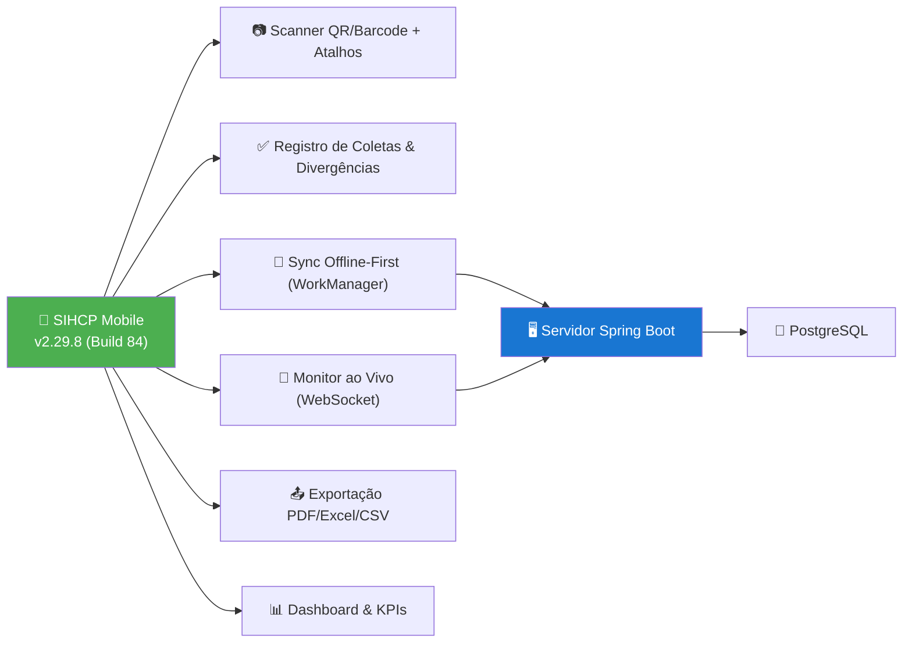
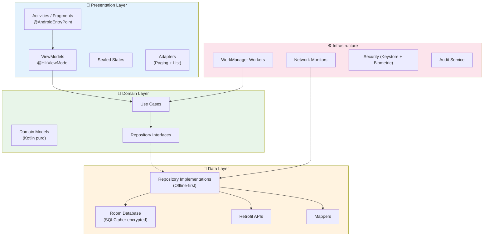
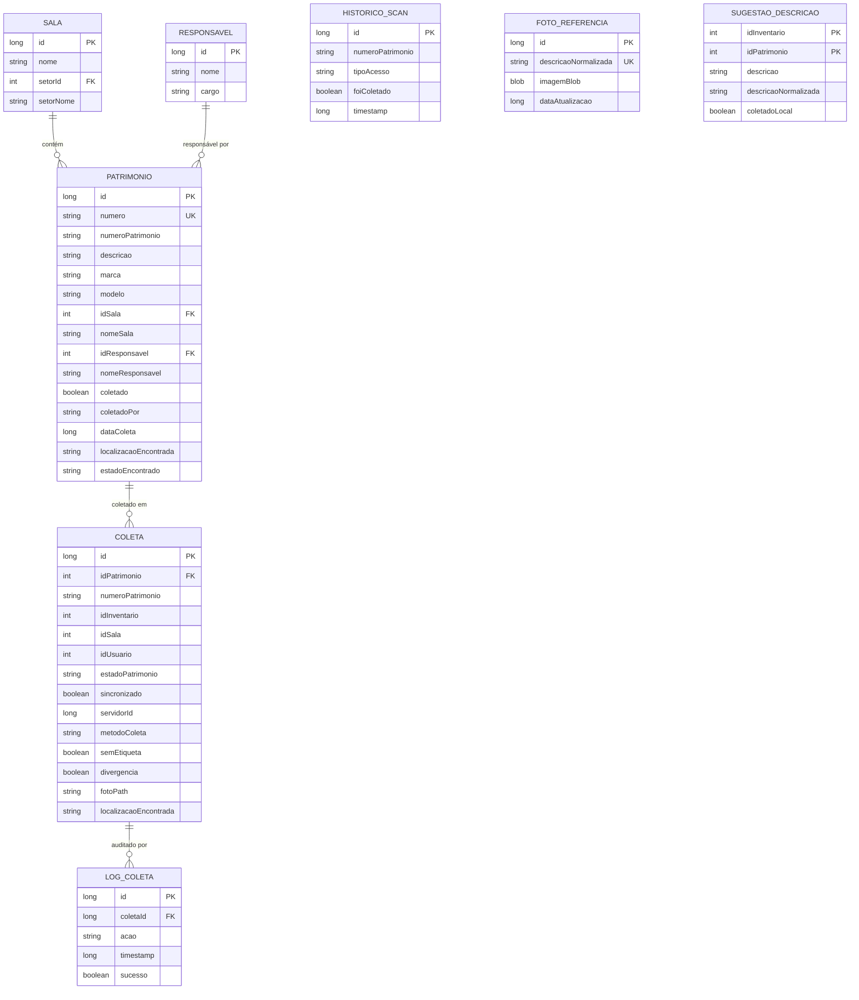
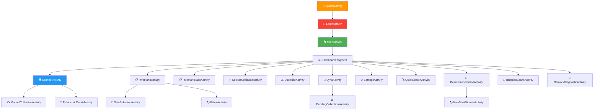
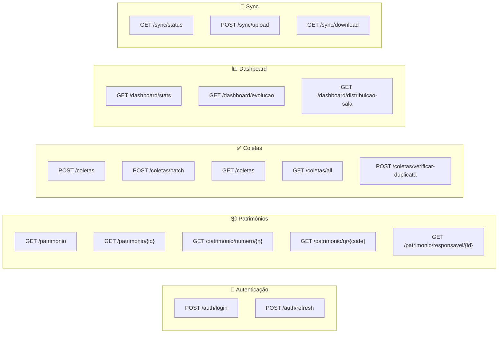
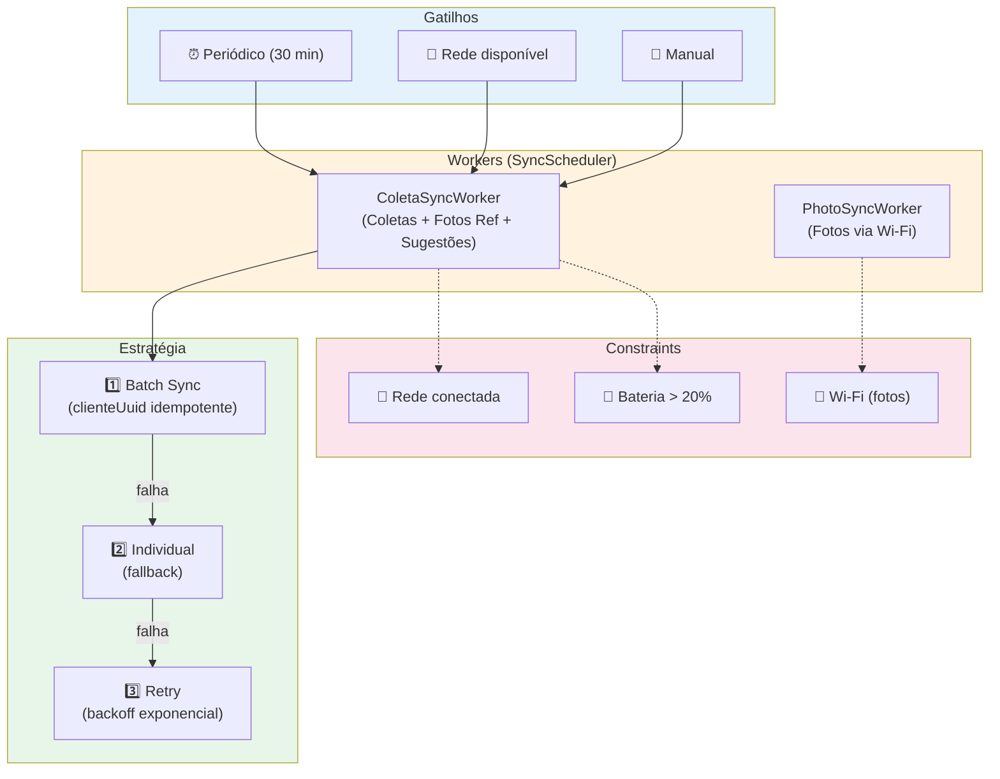
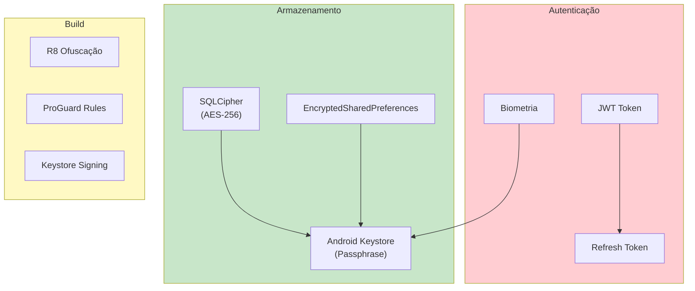

# Documentação do Projeto InventarioMobile

## Visão Geral

O **InventarioMobile** (SIHCP Mobile) é um aplicativo Android nativo desenvolvido em Kotlin para o Instituto Federal de Mato Grosso (IFMT). Permite coleta de patrimônios via QR Code, código de barras, busca manual, busca por descrição ou cadastro de item sem etiqueta, com suporte completo a modo offline, sincronização inteligente, monitor ao vivo via WebSocket e exportação de relatórios.



---

## 📋 Informações do Projeto

| Campo | Valor |
|-------|-------|
| **Nome** | SIHCP Mobile (`InventarioMobile`) |
| **Versão** | `2.29.8` (`versionCode 84`) |
| **Package / Application ID** | `com.inventario.mobile` |
| **Compile SDK** | `34` |
| **Min SDK** | `23` (Android 6.0) |
| **Target SDK** | `34` (Android 14) |
| **Linguagem** | Kotlin `1.9.10` (`jvmTarget = 1.8`) |
| **Build System** | AGP `8.1.4` + Gradle `8.4` + KSP `1.9.10-1.0.13` |
| **Arquitetura** | Clean Architecture + MVVM (Offline-First) |
| **DI** | Dagger Hilt `2.48` + `hilt-work:1.1.0` |

---

## 🏗️ Arquitetura



---

## 📁 Estrutura de Pacotes

```
com.inventario.mobile/
├── InventarioMobileApplication.kt     # @HiltAndroidApp
│
├── api/                                # Interfaces Retrofit auxiliares (2 arquivos)
├── auth/                               # Autenticação e tokens
├── config/                             # Configurações do app
├── data/                               # 💾 Camada de Dados
│   ├── audit/                          #   Serviço de auditoria
│   ├── local/                          #   Fontes locais
│   │   ├── dao/                        #     DAOs Room (11 DAOs ativos / 12 arquivos)
│   │   ├── database/                   #     AppDatabase (SQLCipher 4.6.1, v19)
│   │   └── entity/                     #     Entities Room (10 ativas / 11 arquivos)
│   ├── model/                          #   DTOs e modelos internos
│   ├── pdf/                            #   PdfGenerator (iText 7)
│   ├── realtime/                       #   WebSocket ao vivo (RealtimeColetasManager, ColetaEvento)
│   ├── remote/                         #   Fontes remotas
│   │   ├── api/                        #     Interfaces Retrofit (12 arquivos)
│   │   └── dto/                        #     Request/Response DTOs
│   ├── mapper/                         #   Conversores Entity↔Domain (9 mappers)
│   └── repository/                     #   Implementações de repositórios (15 arquivos)
│
├── di/                                 # 💉 Módulos Hilt (13 módulos)
│   ├── DatabaseModule.kt
│   ├── RepositoryModule.kt
│   ├── ApiModule.kt
│   └── MapperModule.kt
│
├── domain/                             # 🎯 Camada de Domínio
│   ├── model/                          #   Modelos puros (27 arquivos)
│   ├── repository/                     #   Interfaces de repositórios (12 contratos)
│   ├── usecase/                        #   Casos de uso (38 UseCases)
│   └── validator/                      #   Validadores de negócio (ColetaValidator)
│
├── network/                            # 🌐 Monitoramento e interceptores de rede (7 arquivos)
│   ├── ConnectivityMonitor.kt
│   ├── NetworkQualityMonitor.kt
│   ├── RefreshTokenInterceptor.kt
│   └── OfflineFallbackInterceptor.kt
│
├── presentation/                       # 📱 Camada de Apresentação
│   ├── activity/                       #   Activities utilitárias
│   ├── adapter/                        #   Adapters compartilhados
│   ├── charts/                         #   Componentes de gráficos
│   ├── coleta/                         #   Telas de coleta + LiveColetaMonitorViewModel
│   ├── coletas/                        #   Listagem e visualização (ColetasUnificadaActivity)
│   ├── components/                     #   Componentes reutilizáveis
│   ├── dashboard/                      #   DashboardFragment + DashboardUiMapper
│   ├── descricao/                      #   Seleção de descrição
│   ├── detail/                         #   Detalhes do patrimônio
│   ├── dialog/                         #   Diálogos
│   ├── export/                         #   Filtros de exportação
│   ├── filtros/                        #   Filtros avançados
│   ├── historico/                      #   Histórico de scans
│   ├── inventario/                     #   Listagem de inventário
│   ├── login/                          #   Autenticação + Biometria + PIN
│   ├── main/                           #   MainActivity
│   ├── sala/                           #   Seleção de salas
│   ├── scanner/                        #   Scanner QR/Barcode + CustomCaptureActivity + navigation
│   ├── search/                         #   Busca rápida
│   ├── settings/                       #   Configurações
│   ├── setup/                          #   InitialSetupActivity (IP dinâmico v2.29.5+)
│   ├── state/                          #   Sealed classes de estado
│   ├── statistics/                     #   Estatísticas e exportação (ExportFragment)
│   ├── sync/                           #   Sincronização
│   └── viewmodel/                      #   ViewModels compartilhados
│
├── security/                           # 🔐 Segurança (6 classes)
│   ├── SqlCipherKeyManager.kt          #   Passphrase 256-bit via Android Keystore
│   ├── KeystoreRecoveryActivity.kt     #   Recuperação quando Keystore invalida
│   ├── BiometricManager.kt             #   Biometria (1.1.0)
│   ├── PinAuthManager.kt               #   PIN 6 dígitos
│   ├── InputValidator.kt               #   Sanitização e validação
│   └── LogSanitizer.kt                 #   Sanitização de logs
│
├── sync/                               # 🔄 Gerenciamento de sync (5 arquivos)
│   ├── SyncManager.kt                  #   Fachada delegando ao SyncScheduler
│   └── SyncScheduler.kt                #   Agendamento único (WorkManager KEEP)
│
├── ui/                                 # UI base e splash
│   ├── base/
│   ├── coleta/
│   ├── components/
│   └── splash/
│
├── util/ + utils/                      # 🔧 Utilitários
│   ├── PreferencesManager.kt
│   ├── PhotoHelper.kt
│   ├── LegacyPhotoMigrator.kt
│   ├── FotoReferenciaHelper.kt
│   ├── NetworkMonitor.kt
│   └── OfflineNotificationManager.kt
│
└── worker/                             # ⏰ Background Workers (2 Workers)
    ├── ColetaSyncWorker.kt             #   Worker único de sync (coletas + fotos ref + sugestões)
    └── PhotoSyncWorker.kt              #   Upload de fotos em Wi-Fi
```

---

## 🗄️ Banco de Dados (Room + SQLCipher)

### Configuração

| Campo | Valor |
|-------|-------|
| **Nome** | `inventario_offline_secure.db` |
| **Versão** | `19` (`clienteUuid` para idempotência + índice composto `(idPatrimonio, dataColeta)`) |
| **Criptografia** | `net.zetetic:sqlcipher-android:4.6.1` (AES-256) via Android Keystore |
| **Entities registradas** | `10` (`11` arquivos no pacote `entity`) |
| **DAOs registrados** | `11` (`12` arquivos no pacote `dao`) |
| **Migrações** | `15` (`v4` → `v19`, sem `fallbackToDestructiveMigration`) |

### Diagrama de Entidades



### Entities Detalhadas

#### PatrimonioEntity
- 22 campos com índices otimizados (único + compostos)
- Campos de auditoria: `localizacaoEncontrada`, `estadoEncontrado` (v2.20.7)
- Índices compostos para filtros de busca rápida

#### ColetaEntity
- 40+ campos incluindo métricas de performance
- Suporte a itens sem etiqueta (v2.7)
- Foto opcional com path local (v2.11)
- Divergência automática (v2.13)
- Localização encontrada separada (v2.20.12)

---

## 📱 Telas (Activities)



| Activity | Função | Pacote |
|----------|--------|--------|
| `SplashActivity` | Tela inicial | `ui.splash` |
| `LoginActivity` | Autenticação + Biometria | `presentation.login` |
| `MainActivity` | Navegação principal | `presentation.main` |
| `ScannerActivity` | Scanner QR/Barcode | `presentation.scanner` |
| `ManualCollectionActivity` | Coleta manual | `presentation.coleta` |
| `CollectionViewActivity` | Visualizar coletas | `presentation.coleta` |
| `ColetasUnificadaActivity` | Coletas unificada | `presentation.coletas` |
| `ItemSemEtiquetaActivity` | Item sem etiqueta | `presentation.coleta` |
| `DescricaoSelectionActivity` | Seleção por descrição | `presentation.descricao` |
| `InventarioActivity` | Lista de patrimônios | `presentation.inventario` |
| `InventarioTabsActivity` | Inventário por tabs | `presentation.inventario` |
| `SalaSelectionActivity` | Seleção de salas | `presentation.sala` |
| `SyncActivity` | Sincronização | `presentation.sync` |
| `PendingCollectionsActivity` | Coletas pendentes | `presentation.sync` |
| `StatisticsActivity` | Estatísticas | `presentation.statistics` |
| `SettingsActivity` | Configurações | `presentation.settings` |
| `FiltrosActivity` | Filtros avançados | `presentation.filtros` |
| `QuickSearchActivity` | Busca rápida | `presentation.search` |
| `PatrimonioDetailActivity` | Detalhes patrimônio | `presentation.detail` |
| `HistoricoScansActivity` | Histórico de scans | `presentation.historico` |
| `NetworkDiagnosticActivity` | Diagnóstico de rede | `presentation.activity` |

---

## 🔌 API Endpoints



**Base URL**: `api/mobile/`

| Grupo | Endpoints | Descrição |
|-------|-----------|-----------|
| **Auth** | 2 | Login JWT + Refresh Token |
| **Patrimônios** | 8+ | CRUD + busca por número/QR/responsável |
| **Coletas** | 6+ | Registro individual/batch + verificação duplicata |
| **Salas** | 4 | Listagem + paginação + por setor |
| **Setores** | 2 | Listagem + por ID |
| **Responsáveis** | 2 | Listagem + por ID |
| **Descrições** | 3 | Listagem + busca + não coletadas |
| **Inventário** | 2 | Ativo + por ID |
| **Dashboard** | 5 | Stats + evolução + distribuição |
| **Sync** | 3 | Status + upload + download |

---

## 🔄 Sincronização



### Workers

| Worker | Função | Intervalo | Constraints |
|--------|--------|-----------|-------------|
| `ColetaSyncWorker` | Worker único de sync (coletas pendentes + fotos de referência + sugestões de descrição) | Configurável / sob demanda | Rede (ou Wi-Fi) + Bateria |
| `PhotoSyncWorker` | Upload de fotos de coleta (multipart) | Periódico / sob demanda | Wi-Fi + Bateria |

---

## 🔐 Segurança



| Recurso | Implementação |
|---------|---------------|
| **Banco de dados** | SQLCipher com passphrase via Android Keystore |
| **Autenticação** | JWT + Refresh Token automático |
| **Biometria** | Fingerprint/Face para login rápido |
| **Preferências** | EncryptedSharedPreferences |
| **Build Release** | R8 + minifyEnabled + shrinkResources |
| **Assinatura** | Keystore externo (não versionado) |

---

## 📦 Dependências Principais

### Core
| Dependência | Versão | Uso |
|-------------|--------|-----|
| Kotlin | `1.9.10` | Linguagem |
| Android Gradle Plugin | `8.1.4` (Gradle `8.4`) | Build |
| AndroidX Core KTX | `1.12.0` | Extensions |
| Material Design | `1.10.0` | UI Components |
| Navigation | `2.7.5` | Navegação |
| Lifecycle | `2.7.0` | ViewModel + LiveData |

### Dados
| Dependência | Versão | Uso |
|-------------|--------|-----|
| Room | `2.6.1` | Banco local (v19) |
| Room Paging | `2.6.1` | Paginação local |
| Paging 3 | `3.2.1` | Scroll infinito |
| SQLCipher (`sqlcipher-android`) | `4.6.1` | Criptografia do banco (AES-256) |
| Retrofit | `2.9.0` | HTTP Client |
| OkHttp Logging | `4.12.0` | Cliente HTTP / WebSocket / Debug |
| Gson | (via Retrofit) | JSON parsing |

### UI
| Dependência | Versão | Uso |
|-------------|--------|-----|
| Glide | `4.16.0` | Imagens |
| MPAndroidChart | `v3.1.0` | Gráficos |
| ZXing | `4.3.0` / `3.5.2` | Scanner QR / Barcode |
| CameraX | `1.3.0` | Preview de câmera |
| SwipeRefreshLayout | `1.1.0` | Pull-to-refresh |

### Infraestrutura
| Dependência | Versão | Uso |
|-------------|--------|-----|
| Hilt | `2.48` (`hilt-work:1.1.0`) | Injeção de dependência |
| WorkManager | `2.9.0` | Background tasks |
| Coroutines | `1.7.3` | Async |
| Biometric | `1.1.0` (stable) | Autenticação biométrica |
| Security Crypto | `1.1.0-alpha06` | Preferências seguras (Tink) |
| iText | `7.2.5` | Geração de PDF |
| ThreeTenABP | `1.4.6` | Date/Time |

### Testes
| Dependência | Versão | Uso |
|-------------|--------|-----|
| JUnit | `4.13.2` | Testes unitários |
| Kotest | `5.8.0` | Property-based testing |
| jqwik | `1.8.4` | Property-based testing (JUnit 5) |
| MockK | `1.12.8` | Mocking |
| Espresso | `3.5.1` | Testes de UI |
| Hilt Testing | `2.48` | DI em testes |

---

## 📋 Permissões

| Permissão | Uso | Obrigatória |
|-----------|-----|-------------|
| `INTERNET` | Comunicação com servidor | ✅ |
| `ACCESS_NETWORK_STATE` | Monitorar conectividade | ✅ |
| `CAMERA` | Scanner QR Code | ✅ |
| `ACCESS_FINE_LOCATION` | GPS para coleta | ⚠️ |
| `ACCESS_COARSE_LOCATION` | Localização aproximada | ⚠️ |
| `VIBRATE` | Feedback tátil no scan | ❌ |
| `RECORD_AUDIO` | Busca por voz | ❌ |
| `USE_BIOMETRIC` | Login biométrico | ❌ |
| `FOREGROUND_SERVICE` | Sync em background | ✅ |
| `FOREGROUND_SERVICE_DATA_SYNC` | Tipo de foreground service | ✅ |
| `POST_NOTIFICATIONS` | Notificações de sync | ⚠️ |
| `READ_MEDIA_IMAGES` | Fotos (Android 13+) | ⚠️ |
| `WAKE_LOCK` | Manter CPU durante sync | ❌ |

---

## 🚀 Funcionalidades Principais

### Métodos de Coleta
- **QR Code**: Scan via câmera com ZXing
- **Código de Barras**: Scan de etiquetas
- **Busca Manual**: Por número do patrimônio
- **Por Descrição**: Seleção de descrições não coletadas
- **Item Sem Etiqueta**: Registro com foto obrigatória

### Sincronização
- **Offline-first**: Coletas salvas localmente primeiro
- **Batch Sync**: Múltiplas coletas em uma requisição
- **Background Sync**: WorkManager a cada 30 minutos
- **Smart Sync**: Baseado em qualidade de rede e bateria
- **Photo Sync**: Upload de fotos apenas em Wi-Fi
- **Retry**: Backoff exponencial em falhas

### Exportação
- **PDF**: Relatório completo com estatísticas
- **Excel (TSV)**: Compatível com Excel/LibreOffice
- **CSV**: Formato universal

### Segurança
- **SQLCipher**: Banco criptografado AES-256
- **Android Keystore**: Passphrase segura
- **JWT + Refresh**: Renovação automática de token
- **Biometria**: Login rápido por impressão digital
- **R8**: Ofuscação de código em release

### Monitoramento
- **NetworkQualityMonitor**: Qualidade da rede em tempo real
- **ConnectivityMonitor**: Estado de conectividade
- **AutoSyncManager**: Sync quando servidor volta
- **AuditService**: Log de todas as operações

---

## 🔧 Comandos de Build

```bash
# Build debug
cd InventarioMobile
.\gradlew.bat assembleDebug

# Build release (requer keystore.properties)
.\gradlew.bat assembleRelease

# Instalar no dispositivo
.\gradlew.bat installDebug

# Limpar build
.\gradlew.bat clean

# Rodar testes
.\gradlew.bat test

# Testes instrumentados
.\gradlew.bat connectedAndroidTest
```

---

## 📊 Métricas do Projeto (Varredura Atual)

| Métrica | Valor |
|---------|-------|
| **Arquivos Kotlin (`src/main`)** | `346` (`60.621` linhas) + `50` arquivos de teste (`396` totais) |
| **Arquivos XML (`src/main`)** | `181` (`15.083` linhas; `48` layouts, `6` menus) |
| **Activities** | `26` |
| **Fragments** | `8` |
| **ViewModels** | `22` |
| **Use Cases** | `34` |
| **Repositories (Domain / Data)** | `11` interfaces / `14` implementações |
| **Workers** | `2` (`ColetaSyncWorker` e `PhotoSyncWorker`) |
| **Entities / DAOs Room** | `10` ativas (`11` arquivos) / `11` ativos (`12` arquivos) |
| **Migrações DB** | `15` (`v4` → `v19`) |
| **Remote APIs (`data/remote/api`)** | `11` arquivos + WebSocket `/ws-coletas-live` |
| **Permissões no Manifesto** | `15` |

---

## ✅ Status Atual (`v2.29.8` — `versionCode 84`)

### Implementado
- ✅ Clean Architecture + MVVM completo (inclui `DashboardUiMapper`, `ColetaShortcutNavigator`, `InitialSetupActivity`)
- ✅ Hilt DI em todas as telas críticas e Workers (`@HiltWorker`)
- ✅ Paging 3 para listas grandes
- ✅ Sincronização batch + individual + background unificada (`ColetaSyncWorker` + idempotência `clienteUuid`)
- ✅ SQLCipher `4.6.1` com passphrase 256-bit via Keystore + `KeystoreRecoveryActivity`
- ✅ Biometria (`1.1.0` stable) + PIN 6 dígitos + `RefreshTokenInterceptor` thread-safe
- ✅ Monitoramento de coletas ao vivo via WebSocket (`/ws-coletas-live`) com keep ProGuard em `data.realtime.**`
- ✅ Exportação PDF/CSV/Excel + Relatório fotográfico de itens sem etiqueta (`@DownloadClient` com timeouts estendidos)
- ✅ Atalhos rápidos na câmera ao vivo (`CustomCaptureActivity`) e troca de câmera
- ✅ Detecção automática de divergência de localização/estado (envio fiel + recálculo no servidor)
- ✅ R8 (`minifyEnabled` + `shrinkResources`) + regras Tink preservadas em release
- ✅ Coleta forçada em modo offline (`forcarColeta = true`) + limpeza completa de `143` arquivos inutilizados (`v2.29.8` para hash INPI)
- ✅ `51` arquivos de teste unitário (JUnit, Kotest, jqwik, MockK) e `4` instrumentados

---

**Última atualização**: `13/11/2026` (alinhado ao código `v2.29.8` / `Build 84`)  
**Versão do documento**: `4.0.0`
