# Manual do Coletor — SIHCP Mobile

**Aplicativo Android para coleta patrimonial em campo**

Versão do app: 2.29.5 (maio/2026)
Sistema: SIHCP — Sistema de Histórico e Coleta Patrimonial
Instituição: Instituto Federal de Mato Grosso

---

## Sumário

1. [O que é este aplicativo](#1-o-que-é-este-aplicativo)
2. [Instalação](#2-instalação)
3. [Primeiro acesso](#3-primeiro-acesso)
4. [Tela inicial (Dashboard)](#4-tela-inicial-dashboard)
5. [Realizando uma coleta](#5-realizando-uma-coleta)
6. [Visualizando suas coletas](#6-visualizando-suas-coletas)
7. [Sincronização com o servidor](#7-sincronização-com-o-servidor)
8. [Modo offline](#8-modo-offline)
9. [Sala fixada e modo rápido](#9-sala-fixada-e-modo-rápido)
10. [Coleta sem etiqueta](#10-coleta-sem-etiqueta)
11. [Exportação de relatórios](#11-exportação-de-relatórios)
12. [Relatório fotográfico](#12-relatório-fotográfico)
13. [Troca de senha e biometria](#13-troca-de-senha-e-biometria)
14. [Problemas comuns](#14-problemas-comuns)
15. [Glossário](#15-glossário)

---

## 1. O que é este aplicativo

O SIHCP Mobile é o aplicativo que você usa em campo para registrar quais patrimônios estão em cada sala do IFMT durante o inventário.

**O que ele faz por você:**
- Identifica patrimônios pelo QR Code com a câmera do celular
- Permite registrar coletas mesmo sem internet (modo offline)
- Sincroniza automaticamente com o servidor quando houver conexão
- Organiza suas coletas por sala
- Gera relatórios em PDF, Excel (TSV) e CSV para consulta

**O que ele não faz:**
- Cadastrar novos patrimônios (isso é feito pela equipe administrativa no desktop)
- Alterar dados cadastrais (só registra a coleta — quem, quando, onde, estado)
- Finalizar inventários (quem finaliza é o supervisor no desktop)

---

## 2. Instalação

### Requisitos mínimos

- Android 6.0 ou superior (API 23+)
- 200 MB livres no armazenamento interno
- Câmera traseira
- Sensor de biometria (opcional, para login rápido)
- Conexão Wi-Fi ou dados móveis (só na primeira configuração)

### Passos

1. Solicite o arquivo `SiHCP-release-v2.29.5.apk` à equipe de TI do IFMT.
2. No celular, abra o arquivo e toque em **Instalar**.
3. Se o Android bloquear a instalação, vá em **Configurações → Segurança → Fontes desconhecidas** e libere o aplicativo de origem.
4. Abra o app após a instalação.

> **Atenção:** só instale o APK fornecido pela TI oficial do IFMT. Não baixe versões de outras fontes.

### Atualização

Quando uma nova versão for lançada, **sincronize todas as suas coletas pendentes antes de atualizar**. Atualizações de segurança podem recriar o banco local do app — qualquer coleta não sincronizada será perdida.

Como conferir se todas as coletas foram sincronizadas:

- Abra a tela **Coletas** no menu
- Toque no chip **Pendentes**
- Se a lista estiver vazia, você pode atualizar com segurança

---

## 3. Primeiro acesso

### 3.1 Tela de Configuração Inicial (a partir da v2.29.5)

Na primeira vez que o app abrir após a instalação, você verá a tela **Configuração Inicial**. Ela aparece **apenas uma vez** — depois o app já lembra do servidor.

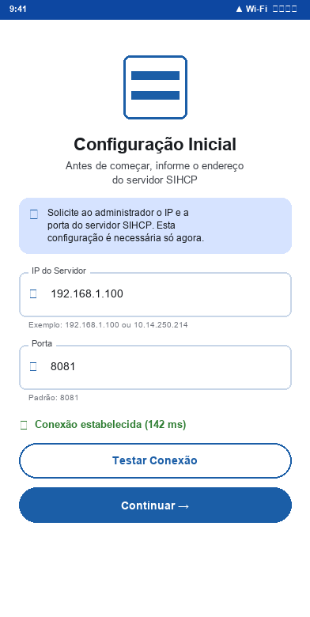

Essa tela substitui o IP fixo que vinha embutido em versões anteriores. Agora você configura o servidor da sua instituição diretamente, sem precisar editar nada na tela de login.

O diagrama abaixo resume o fluxo de primeira utilização:

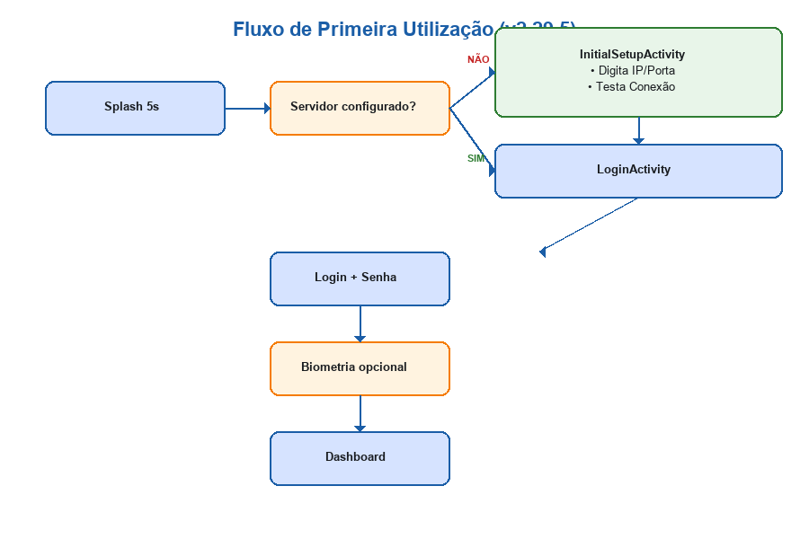

**Passo a passo:**

1. **Pergunte à TI** o IP e a porta do servidor SIHCP (exemplo: `10.14.250.214:8081`).
2. Digite o **IP do Servidor** no campo correspondente. Aceita formato IPv4 (`192.168.1.100`) ou `localhost`.
3. Confira a **Porta** — o padrão é `8081`. Só altere se a TI orientar.
4. Toque em **Testar Conexão**.
   - **Se aparecer um check verde** com o tempo de resposta: tudo certo, pode prosseguir.
   - **Se aparecer um alerta vermelho** com mensagem de erro: confira IP/porta com a TI ou verifique sua rede.
5. Quando o teste tiver sucesso, o botão **Continuar** fica ativo. Toque nele.
6. O app vai direto para a tela de login.

> **O botão "voltar" está bloqueado nesta tela.** Você precisa configurar o servidor para usar o app. Se precisar interromper, feche o app pelo gerenciador de tarefas.

### 3.2 Tela de Login

Na tela de Login:

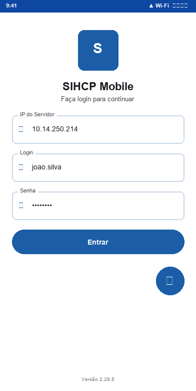

1. **Permissões** — o Android vai pedir câmera, localização e notificações. Aceite todas. A câmera é obrigatória para escanear QR Code.
2. **Login** — informe seu usuário e senha do IFMT. Toque em **Entrar**.
3. **Biometria** (opcional) — se o celular tiver digital ou reconhecimento facial, o app perguntará se quer cadastrar para logins futuros. Recomendado — agiliza o acesso em campo.

> **Mudou o servidor?** O campo **IP do Servidor** continua disponível na tela de login. Edite o IP, faça login normalmente, e o app salva a nova configuração automaticamente. Não precisa reinstalar.

Depois do login, o app baixa automaticamente os dados de patrimônios, salas e o inventário ativo. Isso pode demorar alguns segundos e precisa de internet.

---

## 4. Tela inicial (Dashboard)

Após o login você vê o Dashboard, com:

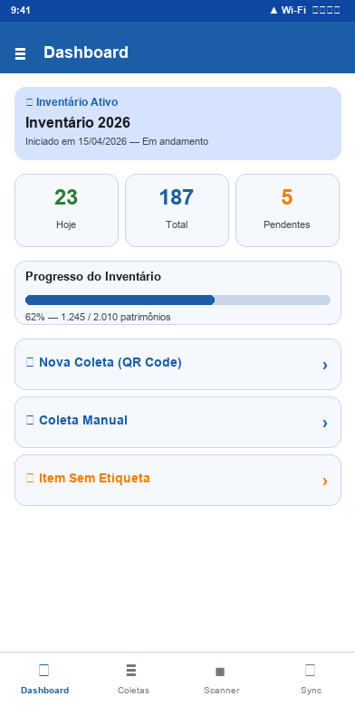

- **Inventário ativo** — nome e período do inventário que está em andamento
- **Suas coletas hoje** — quantos patrimônios você registrou no dia
- **Total de pendências de sincronização** — coletas que ainda não foram enviadas ao servidor
- **Botões rápidos** — iniciar nova coleta, abrir scanner, ver minhas coletas

Na parte inferior há a barra de navegação com quatro itens fixos:

| Ícone | Item | O que faz |
|---|---|---|
| Casa | Dashboard | Volta para esta tela |
| Prancheta | Coletas | Lista todas as coletas que você tem |
| Código QR | Scanner | Abre a câmera para escanear |
| Sincronizar | Sincronização | Envia coletas pendentes ao servidor |

O menu lateral (ícone de três linhas no topo) traz opções adicionais: Minhas Coletas, Histórico de Scans, Relatórios, Configurações, Sobre o App, Sair.

---

## 5. Realizando uma coleta

Toda coleta começa escolhendo uma **sala**. Vá em qualquer uma das três formas:

- Dashboard → botão **Nova Coleta**
- Menu lateral → **Scanner QR Code**
- Barra inferior → **Scanner**

Você será levado à lista de salas para selecionar onde está trabalhando. Toque na sala certa.

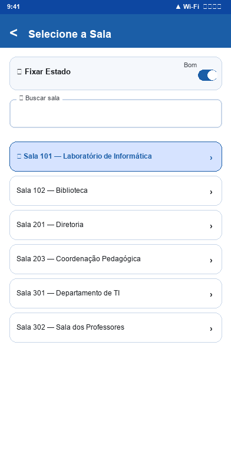

Depois de escolher a sala, o app apresenta três tipos de coleta. Escolha o que fizer sentido para o item à sua frente.

### 5.1 Coleta por QR Code (mais rápida)

Quando o patrimônio tem a plaqueta com QR Code visível.

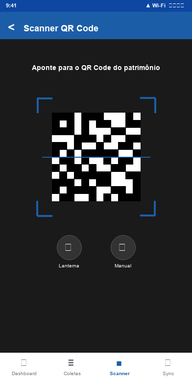

1. Aponte a câmera para o QR Code.
2. O app reconhece o código automaticamente e mostra os dados do patrimônio.

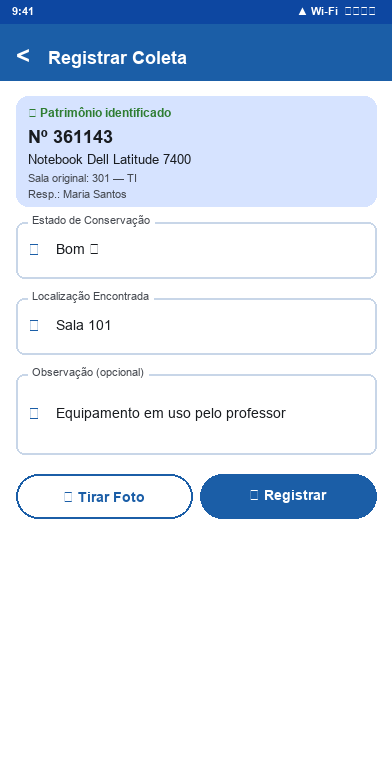

3. Confira a descrição — é o item que você está vendo?
4. Informe o **estado de conservação** (Ótimo, Bom, Regular, Ruim, Inservível).
5. Opcional: adicione uma **observação** (ex.: "tela trincada").
6. Toque em **Registrar**.

O app faz uma vibração curta para confirmar. A coleta vai para a lista de pendências e é sincronizada em segundo plano.

**Duplicatas:** se o patrimônio já foi coletado nesse inventário, o app avisa antes de registrar. O comportamento depende do estado da conexão:

- **Com internet** (online): o app consulta o servidor antes de bloquear. Se a coleta foi excluída no servidor (por outro coletor ou pelo desktop), o app **permite recoletar** sem avisar de duplicata.
- **Sem internet** (offline): o app verifica o cache local. Se já existe uma coleta para o mesmo patrimônio no banco local, ele **bloqueia** para evitar duplicatas reais. Se a coleta foi excluída no servidor durante o período offline, esse bloqueio é falso e some assim que o app sincronizar.

### 5.2 Coleta manual (digitando o número)

Use quando o QR Code está ilegível mas você consegue ler o número da plaqueta.

1. Na tela da sala escolhida, toque em **Coleta Manual**.
2. Digite o número do patrimônio (pode ser só o número, sem prefixo — o app completa).
3. Confira os dados que aparecem — confere?
4. Preencha estado e observações como na coleta por QR.
5. Toque em **Registrar**.

### 5.3 Coleta por descrição (quando não há identificação)

Use quando você encontra um item patrimoniável mas não consegue identificar qual é (plaqueta caiu, ilegível, mas ainda consegue saber o tipo do item).

1. Na tela da sala escolhida, toque em **Coletar por Descrição**.
2. Digite parte da descrição (ex.: "cadeira") na busca.
3. O app lista só os patrimônios que **ainda não foram coletados** nessa descrição.
4. Toque no item que corresponde ao que você tem à mão.
5. Preencha estado, observações e registre.

**Dica:** como a lista só mostra o que ainda está pendente, é rápido eliminar opções conforme você avança na sala.

### 5.4 Escolhendo o estado de conservação

| Estado | Quando usar |
|---|---|
| **Ótimo** | Sem marcas de uso, parece novo |
| **Bom** | Funciona bem, sinais normais de uso |
| **Regular** | Funciona mas tem desgaste significativo |
| **Ruim** | Funciona com dificuldade ou tem defeitos |
| **Inservível** | Não funciona, destinar ao descarte |

---

## 6. Visualizando suas coletas

Na barra inferior, toque em **Coletas**. A tela mostra todas as coletas que você já fez (online e offline).

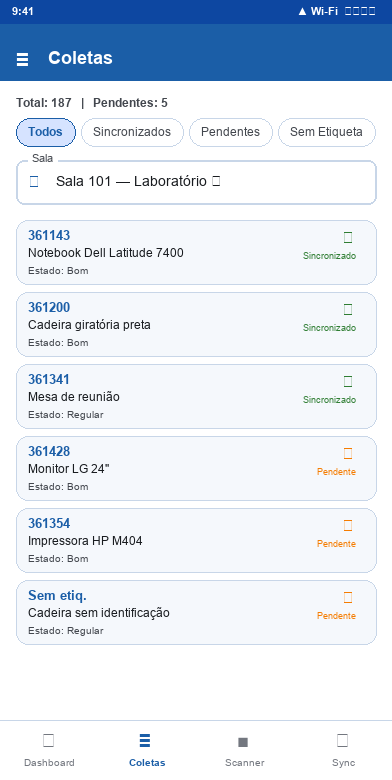

**Filtros disponíveis:**

- **Busca por texto** — digite número de patrimônio ou descrição
- **Chips de status** — Todos, Coletados (sincronizados), Pendentes (offline), Sem Etiqueta
- **Chip Minhas Coletas** — só o que você coletou (desliga coletas de outros coletores se houver)
- **Spinner de sala** — filtra por uma sala específica
- **Agrupar** — organiza a lista por sala

**Ações em uma coleta:**

- **Toque simples** — vê detalhes
- **Segurar o dedo (long-click)** em coleta **Pendente** — abre menu com *Reenviar Coleta* e *Excluir Coleta*
- **Segurar o dedo** em coleta **Sincronizada** — avisa que não pode ser alterada pelo app (precisa do desktop)

### Contadores no topo

- **Total** — quantas coletas aparecem no filtro atual
- **Pendentes** — quantas delas ainda não foram enviadas ao servidor

### Pull-to-refresh

Arraste a tela para baixo para recarregar dados do servidor.

---

## 7. Sincronização com o servidor

O app sincroniza suas coletas com o servidor de três formas:

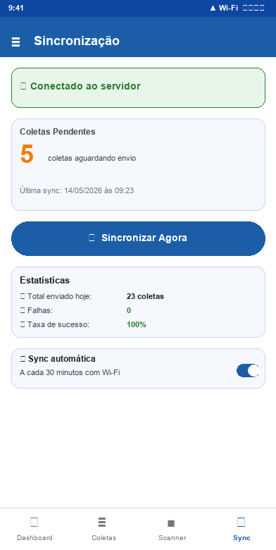

### 7.1 Automática (recomendado)

Sempre que você tem internet, o app envia novas coletas em segundo plano a cada 30 minutos. Você não precisa fazer nada.

### 7.2 Manual imediata

Na barra inferior, toque em **Sincronização**. Você verá:

- Número de coletas pendentes
- Último momento de sincronização
- Botão **Sincronizar Agora**

Toque no botão e aguarde. Uma barra de progresso indica o envio. Ao final, o app mostra quantas coletas foram enviadas com sucesso e quantas falharam.

### 7.3 Reenvio individual

Se uma coleta específica não foi aceita pelo servidor (erro de rede, dados inválidos), segure o dedo sobre ela na lista e toque em **Reenviar Coleta**.

### Falhas comuns de sincronização

| Mensagem | O que significa | O que fazer |
|---|---|---|
| "Sem conexão" | Wi-Fi/dados móveis off ou servidor inacessível | Verifique sua conexão; continue coletando offline |
| "Sessão expirada" | Token de autenticação expirou | O app pedirá biometria ou senha para renovar |
| "Muitas tentativas, aguarde X segundos" | Rate limit do servidor (proteção anti-força-bruta) | Aguarde o tempo indicado e tente de novo |
| "Patrimônio já coletado" | Alguém coletou o mesmo item antes de você | A coleta antiga prevalece; verifique se é o mesmo item |
| "Inventário finalizado" | O inventário ativo terminou | Sincronize o que puder e faça login de novo para pegar o novo inventário |

---

## 8. Modo offline

O app funciona **sem internet** para todas as operações de coleta. Os dados necessários (patrimônios, salas, descrições) são baixados do servidor no login e ficam armazenados no celular de forma criptografada.

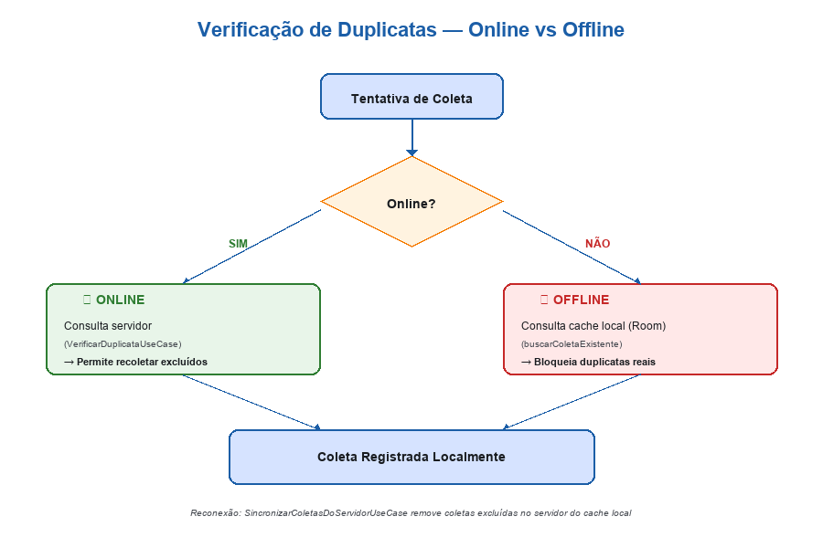

**Quando você está offline, você pode:**
- Fazer coletas por QR Code, manual ou descrição
- Ver suas coletas anteriores
- Buscar patrimônios
- Filtrar por sala, status, descrição

**O que exige internet:**
- Login inicial (primeira autenticação)
- Sincronização (enviar coletas ao servidor)
- Exportação para PDF/Excel/CSV
- Renovação de sessão expirada

Quando a internet volta, o app sincroniza automaticamente. Se notar que alguma coleta ficou pendente por muito tempo, abra **Sincronização** e force manualmente.

### Acesso offline com biometria

Se você configurou biometria no primeiro login, pode abrir o app sem internet desde que já tenha autenticado antes naquele dispositivo. Ao abrir o app offline, ele pedirá digital ou reconhecimento facial.

---

## 9. Sala fixada e modo rápido

Dois recursos aceleram o trabalho quando você passa muito tempo na mesma sala ou faz muitas coletas com o mesmo estado de conservação.

### 9.1 Sala fixada

Na tela de **Seleção de Sala**, segure o dedo sobre o nome de uma sala. Um menu aparece com **📌 Fixar esta sala**.

Enquanto a sala estiver fixada:
- Ela aparece com destaque no topo da lista
- Um atalho surge no Dashboard para ir direto à coleta

Para remover a fixação: long-click de novo e toque em **Remover fixação**.

### 9.2 Modo rápido (estado fixo)

Na tela de **Seleção de Sala**, há o switch **Fixar Estado**.

Ative-o e escolha um estado (ex.: "Bom"). A partir daí:
- Todas as coletas que você fizer usarão esse estado automaticamente
- O diálogo de confirmação de estado é pulado
- Seu ritmo aumenta bastante em salas com muitos itens em mesmo estado

Para voltar ao normal, desligue o switch.

> **Atenção:** modo rápido não dispensa a verificação visual. Se você estiver em modo rápido "Bom" e encontrar um equipamento quebrado, mude o estado antes de registrar.

---

## 10. Coleta sem etiqueta

Se você encontrar um item patrimoniável que claramente não tem plaqueta (nem legível nem caída por perto), registre-o como **Sem Etiqueta**.

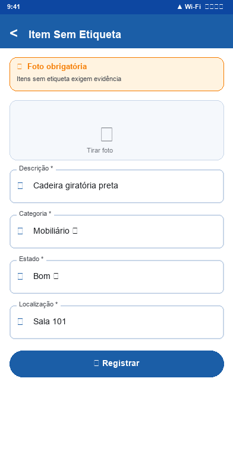

1. No Dashboard ou no scanner, toque em **Item Sem Etiqueta**.
2. Preencha:
   - **Descrição** (obrigatório): o que é o item (ex.: "Cadeira giratória preta")
   - **Categoria** (dropdown): Mobiliário, Eletrônico, Eletrodoméstico, Informática, Outro
   - **Estado de conservação** (obrigatório)
   - **Localização encontrada** (obrigatório): descreva onde está
   - **Observações** (opcional)
   - **Foto** (obrigatória): tire uma foto do item

3. Toque em **Registrar**.

Esses itens sobem para o servidor com a marcação `SEM_ETIQUETA` e depois a equipe administrativa decide se:
- Emite nova plaqueta e identifica qual patrimônio é
- Cadastra como patrimônio novo
- Marca como descarte

---

## 11. Exportação de relatórios

No menu lateral → **Relatórios** ou na aba Exportação.

Escolha:
- **Formato**: PDF, Excel (TSV) ou CSV
- **Filtro**: Todos, Apenas Coletados, Apenas Não Coletados
- **Sala** (opcional): limitar a uma sala específica

Toque em **Gerar Relatório**. O arquivo é salvo no celular e você pode:
- **Abrir** no aplicativo correspondente (PDF, Excel, editor de texto)
- **Compartilhar** via WhatsApp, e-mail, Drive, etc.

O relatório contém: número de patrimônio, descrição, sala, estado, coletor, data, status de sincronização. Nos agrupados, traz totais por sala e percentual de conclusão do inventário.

---

## 12. Relatório fotográfico

A partir da v2.29.0, supervisores podem gerar um **Relatório Fotográfico** em PDF com todas as fotos das coletas registradas no inventário. Útil para auditar visualmente os itens encontrados, especialmente os sem etiqueta.

> **Quem pode usar:** apenas perfis SUPERVISOR ou ADMIN. Coletores não veem este botão.

### Como gerar

1. Menu lateral → **Coletas**.
2. Toque no ícone de relatório fotográfico (geralmente um ícone de câmera no menu superior).
3. O app primeiro verifica quantas fotos estão disponíveis no servidor (endpoint `/info`).
4. Se houver fotos, toque em **Baixar PDF**.
5. Aguarde o download — uma barra de progresso aparece. PDFs grandes (1–5 MB com muitas fotos) podem levar até 6 minutos em redes móveis lentas.
6. Quando concluir, o app oferece abrir ou compartilhar o arquivo.

### Filtros disponíveis

O relatório pode ser filtrado por tipo:

- **Todos** — todas as coletas que têm foto
- **Patrimônio** — apenas coletas de itens com plaqueta
- **Sem Etiqueta** — apenas itens encontrados sem identificação
- **Divergência** — apenas coletas marcadas com divergência

E também por **sala** específica, se você quiser focar em uma área do inventário.

### O que aparece no PDF

Cada coleta vira um "card" com:
- Foto do item (se tirada)
- Número do patrimônio (ou "Sem etiqueta")
- Descrição
- Sala de origem e local onde foi encontrado
- Estado de conservação
- Coletor responsável
- Data e hora da coleta
- Observações
- Motivo da divergência (se houver)

### Falhas comuns

| Mensagem | Causa | Solução |
|---|---|---|
| "Tempo limite excedido" | Rede móvel lenta para PDF grande | Tente em Wi-Fi |
| "Sem permissão" | Seu perfil não é SUPERVISOR/ADMIN | Não usar este recurso |
| "Nenhuma foto disponível" | Inventário sem fotos | Coletas precisam ter fotos anexadas |
| "Erro de rede" | Servidor indisponível ou IP errado | Confira sincronização e configuração |

> **Excel:** também é possível gerar o relatório em formato XLSX com fotos embutidas na primeira coluna. O fluxo é o mesmo, escolhendo o ícone de Excel em vez de PDF.

---

## 13. Troca de senha e biometria

### Trocar senha

A troca de senha é feita no sistema institucional (SUAP ou plataforma IFMT), não pelo app. Após trocar lá, na próxima vez que o app pedir senha, use a nova.

### Cadastrar biometria

1. Menu lateral → **Configurações** → **Segurança**.
2. Toque em **Habilitar biometria**.
3. Confirme com sua senha uma vez.
4. Siga as instruções do Android para registrar digital ou face.

A partir do próximo login, o app pede biometria em vez de senha.

### Desabilitar biometria

No mesmo menu, toque em **Desabilitar biometria**. O app volta a pedir senha no login.

---

## 14. Problemas comuns

### O scanner não lê o QR Code

- Certifique-se de que a câmera tem permissão (Configurações do Android → Apps → SIHCP → Permissões).
- Limpe a lente do celular.
- Ajuste a distância: muito perto ou longe demais não funciona.
- Se a iluminação estiver ruim, use a lanterna (ícone dentro do scanner).
- Se a plaqueta está danificada, use coleta manual.

### Meu login não funciona

- Confira usuário e senha com calma (sem espaços no início/fim).
- Verifique se tem internet na primeira tentativa.
- Se errou três vezes, aguarde alguns minutos (há bloqueio temporário por segurança).
- Se o problema persistir, entre em contato com a TI.

### "Servidor indisponível"

- Verifique Wi-Fi ou dados.
- Pergunte à TI se o servidor está no ar.
- Se o problema for só seu, reinicie o app.
- Enquanto isso, continue coletando offline — os dados ficam salvos.

### O app fechou sozinho

- Abra de novo — o banco local preserva todas as coletas pendentes.
- Se acontecer repetidamente, reinicie o celular.
- Se persistir, informe à TI com detalhes: quando aconteceu, em qual tela, qual modelo de celular.

### Perdi a lista de salas

- Menu lateral → **Sincronização** → **Sincronizar do Servidor**. Isso recarrega toda a base.

### Minhas coletas sumiram

Isso **não deveria** acontecer. Se acontecer:
- Não desinstale o app ainda.
- Entre em contato imediatamente com a TI do IFMT informando seu usuário e aproximadamente quantas coletas estavam pendentes.

### Configurei o IP errado na primeira tela. Como mudar?

A configuração inicial fica salva. Você tem duas formas de corrigir:

- **Mais simples:** abra a tela de Login e edite o IP no campo "IP do Servidor". Faça login normalmente — o app salva o novo IP automaticamente.
- **Reiniciar a configuração inicial:** vá em **Configurações do Android → Apps → SIHCP → Armazenamento → Limpar dados**. O app volta ao estado de primeira instalação e mostra a tela de configuração inicial novamente. **Atenção:** isso apaga coletas pendentes ainda não sincronizadas.

### Item já coletado, mas a coleta foi excluída — não consigo recoletar

Pode acontecer em duas situações:

- **Online:** a partir da v2.29.5 o app consulta o servidor antes de bloquear. Se ainda apresenta o erro, force uma sincronização (puxar para baixo na tela de Coletas) e tente de novo.
- **Offline:** o app verifica o cache local e bloqueia até sincronizar. Conecte-se à internet e abra a tela de Sincronização para forçar a atualização. Após sincronizar, a recoleta passa a ser permitida.

---

## 15. Glossário

- **Coleta** — registro de que um patrimônio foi encontrado em determinada sala, em determinado estado, por determinado coletor.
- **Coleta pendente** — coleta feita no app mas ainda não enviada ao servidor (sem internet, por exemplo).
- **Coleta sincronizada** — coleta que chegou ao servidor e foi aceita.
- **Configuração inicial** — tela exibida na primeira utilização do app (v2.29.5+) para configurar o IP/porta do servidor SIHCP.
- **Inventário ativo** — o inventário (campanha anual, por exemplo) que está aberto para receber coletas no momento.
- **JWT** — token de autenticação que o app usa para provar ao servidor que você está logado. Tem validade de 1 hora em produção.
- **Patrimônio** — bem duradouro do IFMT (computador, cadeira, quadro, etc.) com número único de identificação.
- **QR Code** — código bidimensional impresso na plaqueta de cada patrimônio.
- **Relatório fotográfico** — PDF/XLSX gerado a partir das coletas com foto, restrito a perfis SUPERVISOR/ADMIN.
- **Sincronização** — processo de enviar coletas do app para o servidor.
- **Sala fixada** — sala marcada como "minha sala de trabalho atual" para agilizar a navegação.
- **Modo rápido** — recurso que fixa um estado de conservação para todas as próximas coletas.
- **SUAP** — Sistema Unificado de Administração Pública do governo federal, integrado ao SIHCP.

---

**Suporte**

Dúvidas ou problemas que este manual não resolveu? Entre em contato com a equipe de TI do seu campus.
